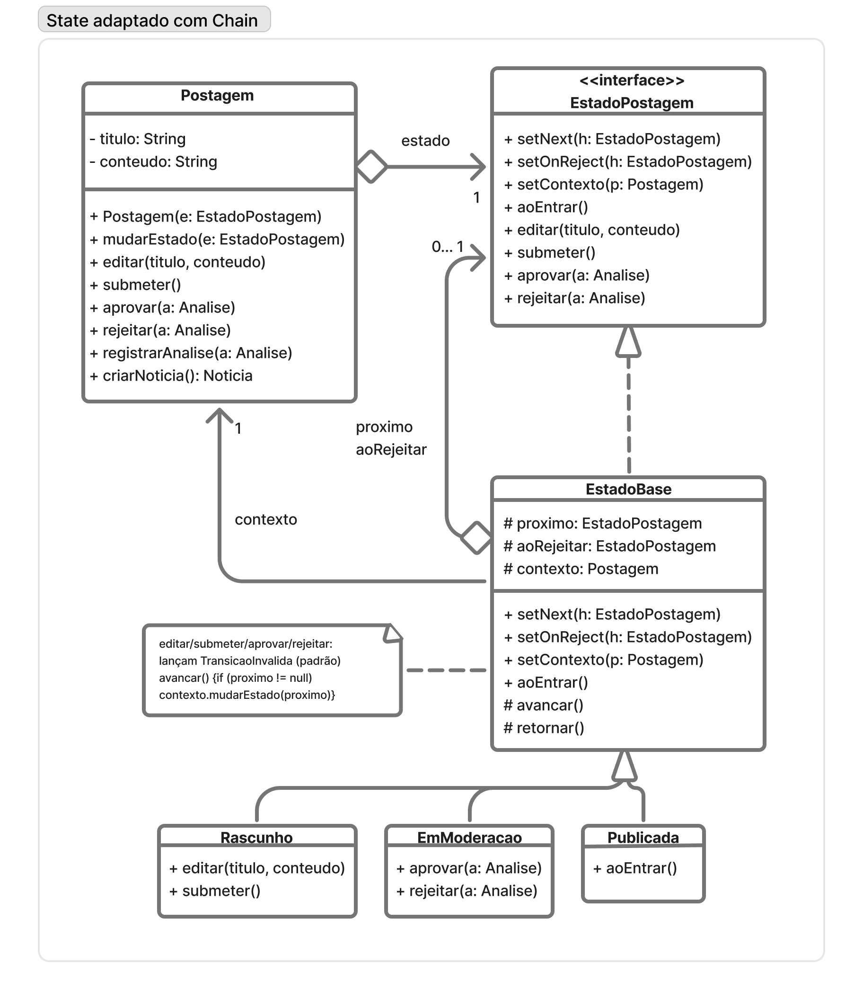
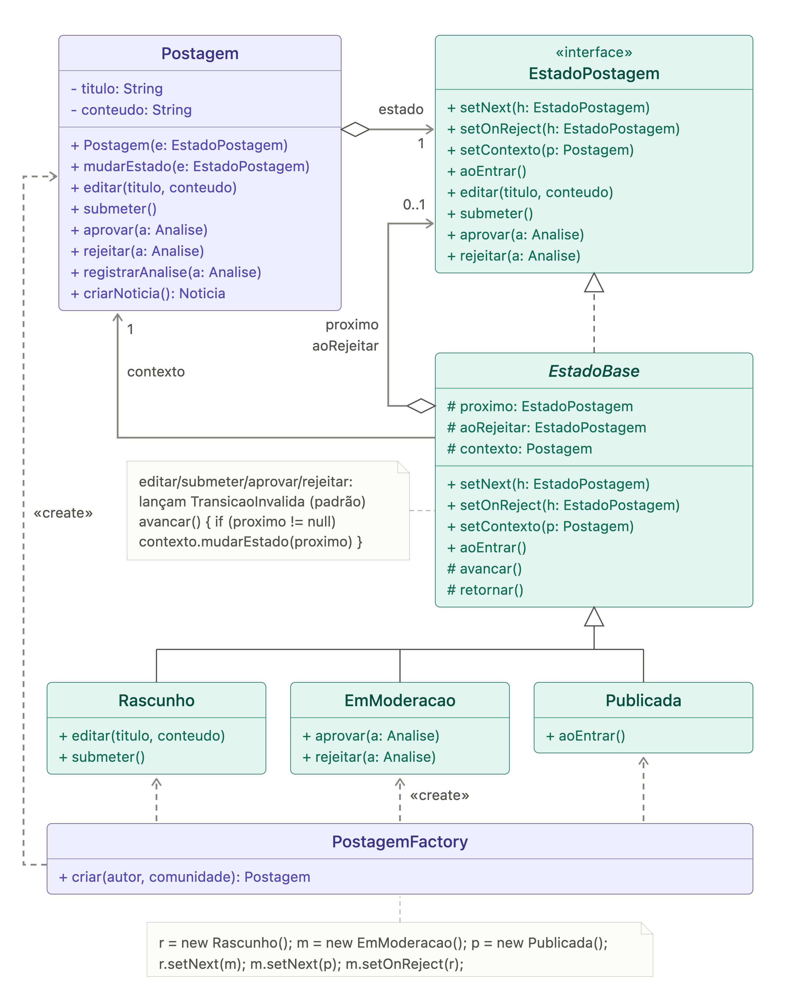
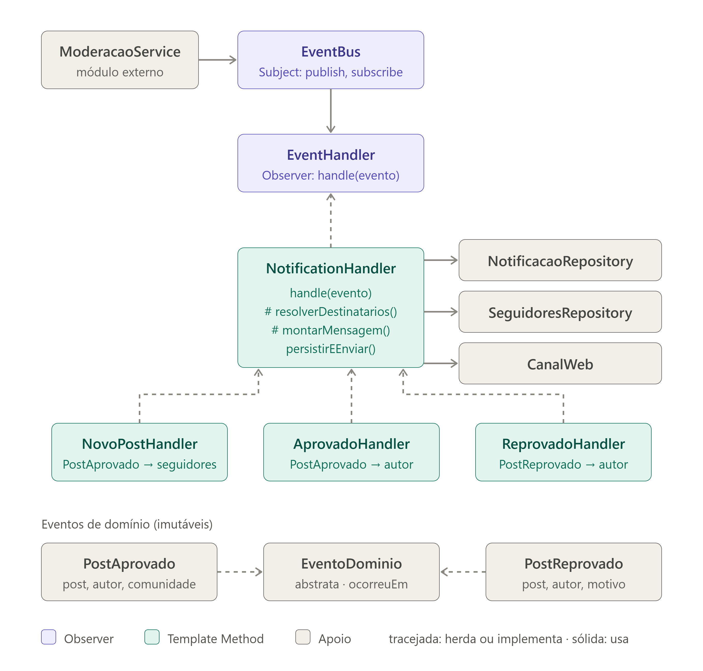
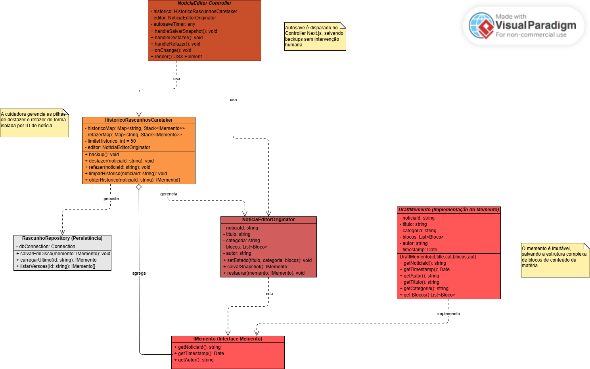
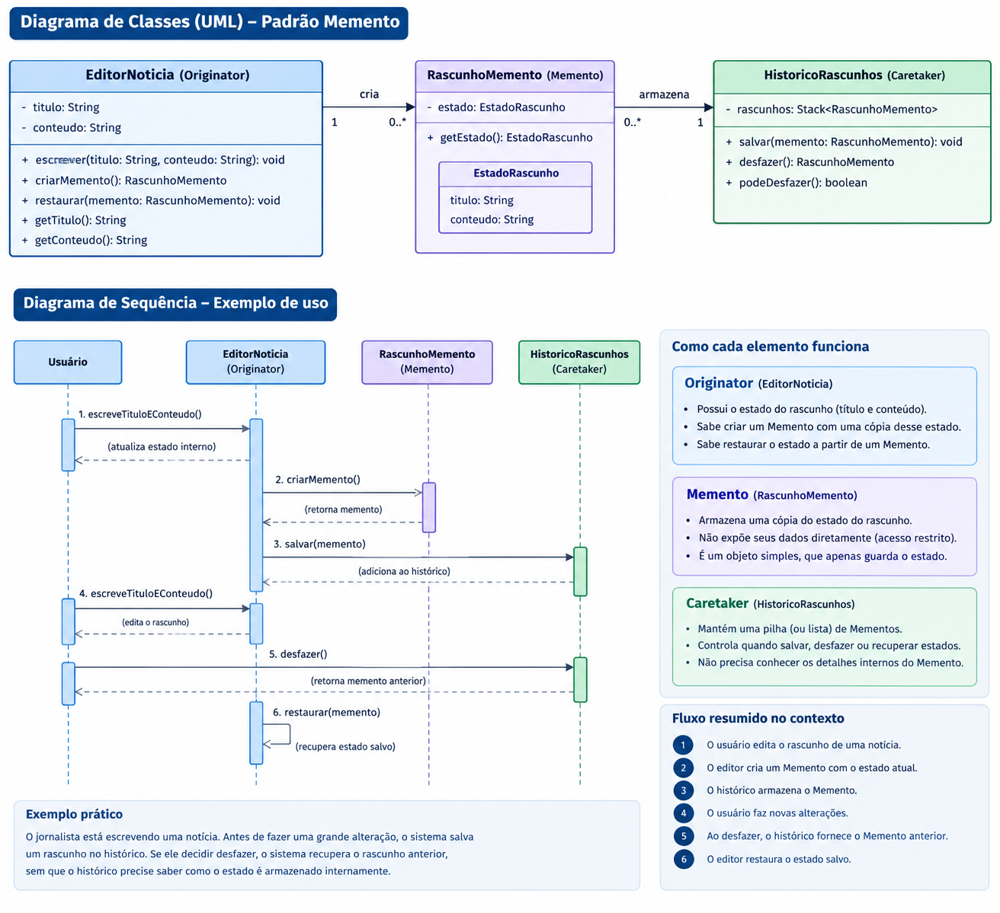
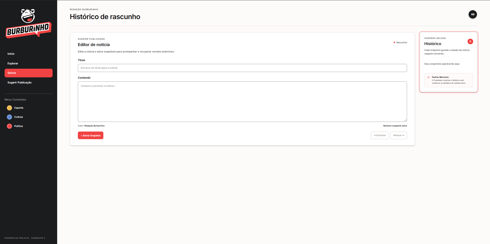

# SubEquipe_02

O relatório contém a estrutura de foco definida para a Entrega 3, além de participantes, metodologia, modelagem, implementação, versionamentos e referências.

## Foco do Relatório

### FOCO_01: GoFs Comportamentais e IA Generativa

**Entrega:** três padrões comportamentais aplicados a problemas reais do Portal de Notícias Burburinho, com modelagem UML, código e vídeo demonstrando cada padrão em execução. O foco também registra as lições aprendidas e o ponto de vista crítico de cada integrante sobre o uso de IA generativa.

O subgrupo não tratará os três padrões como uma única solução. Cada integrante será responsável por um padrão principal, por um cenário específico e por evidências individuais. A integração ocorrerá no relatório e na revisão coletiva, preservando a separação das responsabilidades.

### Participantes no Foco_01

| Nome do Membro | Padrão e lições aprendidas | Uso da IA Generativa (SENSO CRÍTICO) |
|---|---|---|
| Luís Felipe Parreira Cunha | **State combinado com Chain of Responsibility:** o State representa a etapa do ciclo de publicação; a Chain encaminha validações e responsabilidades específicas de cada etapa. A combinação reduz condicionais concentradas no fluxo principal, mas exige deixar claro que se trata de uma adaptação, e não de um novo padrão GoF. | Eu utilizei a IA generativa para discutir alternativas de aplicação do State combinado com Chain of Responsibility e gerar um primeiro rascunho da UML. Não tratei esse resultado como solução final: revisei os participantes, as transições e as responsabilidades, descartei elementos incompatíveis com o Burburinho (como o `PostagemFactory`) e alinhei o diagrama ao código implementado. |
| Matheus Eiki Kimura | **Observer combinado com Template Method:** o `EventBus` atua como sujeito e publica eventos de domínio sem conhecer seus consumidores. Os handlers inscritos atuam como observadores: recebem eventos de novos posts, aprovações e reprovações e encaminham as notificações aos destinatários adequados. A classe abstrata `NotificationHandler` define o fluxo comum de resolução dos destinatários, montagem da mensagem, persistência e envio, enquanto cada handler concreto especializa as etapas que variam. A implementação também permite inscrição e remoção de observadores, evita notificações duplicadas e mantém os demais handlers funcionando quando um deles falha. | A IA foi utilizada como apoio à pesquisa, à modelagem e à revisão da solução. A proposta inicial foi confrontada com o código e com o fluxo real de moderação: foram ajustados os papéis de sujeito e observador, incluída a combinação com Template Method e descartadas simplificações que não representavam a implementação. A validação foi feita com testes de aprovação e reprovação, entrega em tempo real, remoção de duplicidades e isolamento de falhas entre handlers. |
| Pedro Henrique Ferreira Xavier | Ao implementar o **Memento**, aprendi a separar a criação/restauração do estado do editor da responsabilidade de manter o histórico. O `DraftMemento` guarda uma cópia do estado, o `NoticiaEditorOriginator` cria e restaura snapshots, e o `HistoricoRascunhosCaretaker` controla as pilhas de desfazer e refazer sem manipular o conteúdo interno do snapshot. Também compreendi que, ao salvar uma nova versão depois de desfazer, o histórico de refazer precisa ser descartado para não oferecer uma sequência inconsistente. | Usei IA generativa como apoio para estruturar e implementar a demonstração. Ela acelerou a organização inicial das classes e da interface, mas o resultado precisou ser conferido contra os papéis do padrão e o fluxo real de salvar, desfazer e refazer. A IA não substitui essa validação: o modelo, a implementação JavaScript e a versão tipada em TypeScript precisam representar a mesma regra, e a demonstração continua sendo um protótipo em memória, não um mecanismo de persistência de produção. |

## Metodologia do Foco_01

O trabalho será realizado em ciclos:

1. **Levantamento:** revisar os artefatos da Entrega 2 e escolher um problema real para cada padrão.
2. **Modelagem individual:** cada integrante produz uma primeira versão UML, identificando participantes, responsabilidades e relações do padrão.
3. **Implementação individual:** cada integrante implementa o padrão no código do projeto ou em um exemplo executável rastreável ao domínio do Burburinho.
4. **Revisão coletiva:** o subgrupo compara UML e código, verifica se o padrão está realmente presente e corrige responsabilidades, nomes e dependências.
5. **Validação:** cada integrante executa os cenários principais e registra testes ou um roteiro reproduzível.
6. **Demonstração:** cada integrante grava um vídeo curto mostrando o padrão funcionando.
7. **Consolidação:** Luís revisa a integração documental; Eiki confere links e evidências do Observer; Pedro confere a consistência entre UML, código e vídeo do Memento.

As reuniões, decisões, revisões e eventuais alterações devem ser registradas em atas, vídeos ou commits. A IA generativa será apoio para pesquisa, comparação, geração de rascunhos e revisão, mas nenhuma sugestão será considerada evidência final sem análise humana e execução.

**Rastros metodológicos:**

- Atas ou vídeos das reuniões: [Ata da reunião geral do Grupo de 08/10](../1.3.IniciativasExtras.md#reuniao-0810--organizacao-da-entrega-3-e-iniciativas-extras-grupo-geral) · [gravação da reunião no YouTube](https://youtu.be/2wVmp5En10w)
- Discussões e decisões sobre os padrões: [discussão sobre State + Chain of Responsibility no Claude](https://claude.ai/share/fe539575-c510-4408-9234-d57f23803061) · [discussão sobre Memento no ChatGPT](https://chatgpt.com/share/6ad51d4b-3508-83e8-bb24-0c36fde22e3f)

## GoF Comportamental 1 — Luís Felipe Parreira Cunha (State combinado com Chain of Responsibility)

### Contexto (Problema)

Uma postagem passa pelos estados concretos `Rascunho`, `EmModeracao` e `Publicada`. A rejeição é uma decisão da moderação, não um quarto estado concreto no diagrama. Sem uma separação adequada, o controlador concentra condicionais para verificar o estado atual e decidir qual responsabilidade deve ser executada.

O State permite que o comportamento da postagem varie conforme seu estado atual. A Chain of Responsibility complementa a solução encaminhando validações e responsabilidades para handlers específicos. A adaptação foi escolhida porque cada etapa do ciclo pode possuir regras próprias, sem fazer o contexto conhecer toda a lógica de validação.

### Modelagem (Notação UML)

O diagrama final foi revisado para representar o ciclo da sugestão de pauta e a distribuição das responsabilidades:

<figure style="text-align: center;">
    
    <figcaption><p style="text-align: center; font-size: 10pt;">Figura 1: Diagrama final do State combinado com Chain of Responsibility. Fonte: Luís Felipe, 2026.</p></figcaption>
</figure>

O primeiro diagrama foi produzido com apoio de IA e é mantido como evidência do processo de revisão:

<figure style="text-align: center;">
    
    <figcaption><p style="text-align: center; font-size: 10pt;">Figura 2: Rascunho inicial produzido com apoio de IA. Fonte: Luís Felipe, 2026.</p></figcaption>
</figure>

### Uso da IA generativa na minha solução

Eu utilizei a conversa com o Claude para discutir como combinar o State e a Chain of Responsibility no fluxo de publicação e para obter um rascunho inicial da modelagem. A sugestão foi apenas um ponto de partida. Ao revisar o material, confrontei cada participante, transição e responsabilidade com o problema do Burburinho e com a implementação realizada. Nesse processo, descartei o `PostagemFactory`, que não era necessário para a solução, e ajustei o modelo para representar o fluxo efetivamente implementado: `Rascunho`, `EmModeracao` e `Publicada`, além dos handlers de validação.

Essa revisão foi necessária porque a IA pode propor estruturas genéricas ou adicionar classes que não correspondem ao domínio nem ao código final. Portanto, aproveitei a exploração e o rascunho visual, mas a decisão sobre a combinação dos padrões, a modelagem final, a implementação e a validação por execução foi minha.

**Registro da conversa utilizada:** [discussão sobre a modelagem do State combinado com Chain of Responsibility no Claude](https://claude.ai/share/fe539575-c510-4408-9234-d57f23803061)

### Implementação (Código & Vídeo com Padrão em Execução)

Na demonstração, os papéis dos padrões aparecem nos trechos abaixo. Os cards resumem o código para facilitar a leitura; a implementação completa está disponível no repositório.

??? note "1. Postagem e EstadoBase — contexto e transições"
    ```javascript
    export class EstadoBase {
      avancar() {
        if (this.proximo) this.contexto.mudarEstado(this.proximo);
      }

      retornar() {
        if (this.aoRejeitar) this.contexto.mudarEstado(this.aoRejeitar);
      }
    }

    export class Postagem {
      mudarEstado(estado) {
        this.estado = estado;
        this.estado.setContexto(this);
      }
    }
    ```

    `Postagem` é o contexto do State. `EstadoBase` concentra o comportamento comum de avançar para o próximo estado ou retornar pelo caminho de rejeição, sem transferir essas regras para a interface.

??? note "2. Estados concretos — comportamentos permitidos"
    ```javascript
    export class Rascunho extends EstadoBase {
      submeter() {
        this.avancar();
      }
    }

    export class EmModeracao extends EstadoBase {
      aprovar() {
        this.avancar();
      }

      rejeitar() {
        this.retornar();
      }
    }

    export class Publicada extends EstadoBase {}
    ```

    Cada estado expõe somente as ações válidas para sua etapa. Assim, o rascunho pode ser submetido, a publicação em moderação pode ser aprovada ou rejeitada, e o estado publicado não oferece novas transições.

??? note "3. Ligações do State — avanço e rejeição"
    ```javascript
    this.rascunho.setNext(this.emModeracao);
    this.emModeracao.setNext(this.publicada);
    this.emModeracao.setOnReject(this.rascunho);
    ```

    Essas ligações formam o fluxo `Rascunho → EmModeracao → Publicada` e definem o retorno de `EmModeracao` para `Rascunho` quando a publicação é rejeitada.

??? note "4. ValidationHandler — Chain of Responsibility"
    ```javascript
    export class ValidationHandler {
      setNext(handler) {
        this.proximo = handler;
        return handler;
      }

      handle(postagem) {
        this.validar(postagem);
        this.proximo?.handle(postagem);
      }
    }

    export function createValidationChain() {
      const obrigatorio = new ConteudoObrigatorioHandler();
      obrigatorio
        .setNext(new FonteHandler())
        .setNext(new RevisaoEditorialHandler())
        .setNext(new ModeracaoHandler());
      return obrigatorio;
    }
    ```

    Cada handler valida sua responsabilidade e encaminha a postagem ao próximo. A cadeia é executada por `runValidationChain(postagem)` após a submissão, mantendo as validações separadas do contexto da publicação.

Esses são testes manuais guiados pela interface: o estado atual, o feedback e o log tornam cada transição observável. A Chain demonstra o cenário válido, no qual todos os handlers aprovam; a rejeição é uma decisão explícita da etapa de moderação e retorna ao rascunho.

### Funcionamento apresentado no vídeo

O vídeo [GoF Comportamental - Luis SubGrupo2](https://youtu.be/q4J5N93VXrQ) apresenta a implementação funcionando no navegador e relaciona a execução com os diagramas. A sequência demonstrada é:

1. A publicação é preenchida no estado `Rascunho`.
2. Ao clicar em **Submeter para análise**, a interface ativa a etapa **Revise** e abre um modal com o tipo, título e resumo para confirmação.
3. Ao clicar em **Continuar e submeter**, o código chama `Postagem.submeter()`, muda para `EmModeracao` e executa `runValidationChain()`.
4. O **Log da Chain** evidencia o encaminhamento por `ConteudoObrigatorioHandler`, `FonteHandler`, `RevisaoEditorialHandler` e `ModeracaoHandler`. Ao final, `Postagem.registrarAnalise()` registra a análise.
5. Em `EmModeracao`, **Aprovar postagem** chama `EmModeracao.aprovar()`, usa `avancar()` e percorre `setNext` até `Publicada`.
6. No cenário alternativo, **Rejeitar postagem** chama `EmModeracao.rejeitar()`, usa `retornar()` e segue a ligação `setOnReject` de volta para `Rascunho`, onde a publicação pode ser editada e enviada novamente.

Para evidenciar o código durante a apresentação, o modal **Ver detalhes da demonstração** também reúne trechos de `Postagem`, `EstadoBase`, dos estados concretos, das ligações `setNext`/`setOnReject` e da Chain. A implementação completa está em [`app/pattern.js`](https://github.com/UnBArqDsw2026-2-Turma01/2026.2-T01-_G3_ProjetoPortalNoticias_Entrega_03/blob/aedbdee6500be831be57d51d813f8e93dc4f3794/demonstracao_codigos/SubGrupo2/state-com-chain/app/pattern.js), enquanto [`app/page.jsx`](https://github.com/UnBArqDsw2026-2-Turma01/2026.2-T01-_G3_ProjetoPortalNoticias_Entrega_03/blob/aedbdee6500be831be57d51d813f8e93dc4f3794/demonstracao_codigos/SubGrupo2/state-com-chain/app/page.jsx) conecta essas classes às ações da interface. O `PostagemFactory` do diagrama de IA foi deliberadamente desconsiderado, conforme a decisão de modelagem.

**Código hospedado no repositório:** [Demonstração Next.js — State + Chain](https://github.com/UnBArqDsw2026-2-Turma01/2026.2-T01-_G3_ProjetoPortalNoticias_Entrega_03/tree/aedbdee6500be831be57d51d813f8e93dc4f3794/demonstracao_codigos/SubGrupo2/state-com-chain) · [código-fonte e roteiro](https://github.com/UnBArqDsw2026-2-Turma01/2026.2-T01-_G3_ProjetoPortalNoticias_Entrega_03/blob/aedbdee6500be831be57d51d813f8e93dc4f3794/demonstracao_codigos/SubGrupo2/state-com-chain/README.md)

**Vídeo com o padrão em execução:**

<div class="video-embed">
    <iframe
        src="https://www.youtube-nocookie.com/embed/q4J5N93VXrQ"
        title="GoF Comportamental - Luis SubGrupo2"
        loading="lazy"
        allow="accelerometer; autoplay; clipboard-write; encrypted-media; gyroscope; picture-in-picture; web-share"
        allowfullscreen>
    </iframe>
</div>

Se o player não carregar, [assista diretamente no YouTube](https://youtu.be/q4J5N93VXrQ).

## GoF Comportamental 2 - Matheus Eiki Kimura (Observer)
### Contexto (Problema)
??? note "Contexto (problema)"
    O site de notícias UGC permite que usuários criem publicações dentro de comunidades, e toda publicação passa pela moderação antes de ser exibida. Quando o moderador aprova ou reprova um post, o sistema precisa avisar pessoas diferentes pela web: o autor, nos dois casos, e os seguidores da comunidade, quando o post é aprovado.

    Sem um padrão, a solução mais direta seria o ModeracaoService chamar diretamente a lógica de notificação logo após aprovar ou reprovar. Isso gera três problemas:

    Acoplamento forte. A moderação passa a conhecer repositórios de seguidores, o canal web e as regras de cada mensagem. Qualquer mudança nas notificações exige alterar o módulo de moderação.
    Violação do princípio aberto/fechado. Cada novo interessado no evento (por exemplo, um futuro ranking de autores ou um e-mail) obriga a editar o código da moderação, que vira uma cadeia crescente de if e chamadas.
    Falhas em cascata. Se o envio de uma notificação falhar, a própria operação de moderar poderia falhar junto, mesmo sendo apenas um efeito colateral.

    O problema central é que um objeto (a moderação) muda de estado e vários outros objetos precisam reagir a isso, sem que o primeiro saiba quem são eles nem quantos são. Esse é exatamente o problema que o padrão Observer resolve: a moderação publica um evento no EventBus (Subject) e os handlers inscritos (Observers) reagem de forma independente.

    Com o Observer, cada tipo de aviso passou a ter seu próprio handler: avisar os seguidores sobre um novo post, avisar o autor da aprovação e avisar o autor da reprovação. Todos executam a mesma sequência de passos: descobrir quem deve receber, montar a mensagem, salvar a notificação e enviá-la ao navegador do usuário.

    Se cada handler implementasse essa sequência por conta própria, o código de persistência e envio ficaria duplicado em três lugares. Pior, a ordem dos passos poderia divergir entre eles: um handler poderia enviar ao navegador antes de salvar, outro poderia esquecer de remover destinatários repetidos. A cada novo tipo de notificação, essa duplicação e o risco de inconsistência cresceriam.

    O que realmente muda entre os handlers são apenas dois passos: quem recebe e qual é o conteúdo. O restante é idêntico. O problema, portanto, é definir o esqueleto fixo de um algoritmo e permitir que subclasses variem somente partes específicas dele, sem alterar a estrutura geral. É isso que o Template Method resolve: NotificationHandler.handle() fixa a ordem dos passos, enquanto resolveRecipients() e buildMessage() ficam como operações abstratas implementadas por cada handler concreto.

### Modelagem (Notação UML)
??? note "Modelagem Imagem"
    <figure style="text-align: center;">
        
        <figcaption>
            <p style="text-align: center; font-size: 10pt;">
                Figura: Diagrama de classes - Eiki (Fonte: SubEquipe 02, 2026)
            </p>
        </figcaption>
    </figure>

### Implementação (Código & Vídeo com Padrão em Execução)

A implementação executável está na [demonstração Observer + Template Method](https://github.com/UnBArqDsw2026-2-Turma01/2026.2-T01-_G3_ProjetoPortalNoticias_Entrega_03/tree/aedbdee6500be831be57d51d813f8e93dc4f3794/demonstracao_codigos/SubGrupo2/observer). Para manter a explicação objetiva, os cards abaixo mostram apenas os trechos que evidenciam os papéis do Observer e do Template Method; o código completo e os testes estão no repositório.

**Vídeo com o padrão em execução:** [demonstração Observer + Template Method](https://youtu.be/57Q6hmTC6Uo)

??? note "1. EventBus — Subject do Observer"
    ```typescript
    export class EventBus {
      private readonly handlers = new Map<string, EventHandler<any>[]>();

      subscribe<E extends DomainEvent>(handler: EventHandler<E>): () => void {
        const list = this.handlers.get(handler.eventType) ?? [];
        list.push(handler);
        this.handlers.set(handler.eventType, list);
        return () => this.unsubscribe(handler);
      }

      async publish(event: DomainEvent): Promise<void> {
        const list = this.handlers.get(event.type) ?? [];
        await Promise.allSettled(list.map((handler) => handler.handle(event)));
      }
    }
    ```

    O `EventBus` mantém os observadores por tipo de evento, permite sua inscrição e remoção e publica o evento sem conhecer a implementação dos handlers.

??? note "2. NotificationHandler — Template Method"
    ```typescript
    export abstract class NotificationHandler<E extends DomainEvent>
      implements EventHandler<E> {
      async handle(event: E): Promise<void> {
        const recipients = await this.resolveRecipients(event);
        if (recipients.length === 0) return;

        const draft = this.buildMessage(event);
        await this.persistAndSend(recipients, draft);
      }

      protected abstract resolveRecipients(event: E): Promise<string[]>;
      protected abstract buildMessage(event: E): NotificationDraft;
    }
    ```

    `handle()` fixa a ordem do algoritmo. Os handlers concretos variam apenas na resolução dos destinatários e na construção da mensagem; a persistência e o envio permanecem centralizados.

??? note "3. Handlers concretos — reações aos eventos"
    ```typescript
    export class NewPostHandler extends NotificationHandler<PostApprovedEvent> {
      readonly eventType = PostApprovedEvent.TYPE;

      protected async resolveRecipients(event: PostApprovedEvent) {
        const ids = await this.followers.findFollowerIds(event.communityId);
        return ids.filter((id) => id !== event.authorId);
      }

      protected buildMessage(event: PostApprovedEvent): NotificationDraft {
        return {
          type: "NEW_POST_IN_COMMUNITY",
          message: `Nova publicação em ${event.communityName}: ${event.postTitle}`,
          link: `/posts/${event.postId}`,
        };
      }
    }
    ```

    Cada handler reage a um evento e define sua regra de negócio. A implementação remove destinatários duplicados antes de persistir e enviar, evitando que o autor receba a mesma notificação por mais de uma origem.

??? note "4. EventHandler, ModerationService e composição"
    `EventHandler` define o contrato comum dos observers: cada handler informa o tipo de evento que escuta e implementa `handle(event)`. O `ModerationService` conhece somente o `EventBus`; ao aprovar ou reprovar uma publicação, ele persiste a decisão e publica o evento correspondente, sem depender dos handlers, do repositório de notificações ou do canal web.

    A função `buildContainer()` concentra a composição da aplicação. Ela cria o `EventBus`, os repositórios e o canal SSE, inscreve `NewPostHandler`, `ApprovedHandler` e `RejectedHandler` e injeta o bus no serviço de moderação. Assim, a inscrição dos observers fica em um único ponto e o módulo que publica permanece desacoplado dos consumidores.

??? note "5. Validação da execução"
    ```typescript
    await moderation.approve("p1");

    const ana = await notifications.findByRecipient("ana");
    const bruno = await notifications.findByRecipient("bruno");

    assert.deepEqual(ana.map((n) => n.type), ["POST_APPROVED"]);
    assert.deepEqual(bruno.map((n) => n.type), ["NEW_POST_IN_COMMUNITY"]);
    ```

    Os testes confirmam a notificação do autor e dos seguidores, a reprovação com motivo, a entrega via SSE, a tolerância a falhas isoladas em handlers e a rejeição de uma segunda moderação do mesmo post.

**Código hospedado no repositório:** [Demonstração Observer + Template Method](https://github.com/UnBArqDsw2026-2-Turma01/2026.2-T01-_G3_ProjetoPortalNoticias_Entrega_03/tree/aedbdee6500be831be57d51d813f8e93dc4f3794/demonstracao_codigos/SubGrupo2/observer) · [README e instruções de execução](https://github.com/UnBArqDsw2026-2-Turma01/2026.2-T01-_G3_ProjetoPortalNoticias_Entrega_03/blob/aedbdee6500be831be57d51d813f8e93dc4f3794/demonstracao_codigos/SubGrupo2/observer/README.md)

## GoF Comportamental 3 - Memento

#### Contexto (Problema)
No portal, o autor pode editar o título e o conteúdo de uma notícia antes de publicá-la. Durante a edição, uma alteração pode substituir um texto anterior por engano, e o autor precisa recuperar uma versão salva ou reaplicar uma alteração desfeita. Manter cópias do estado espalhadas pela interface deixaria a tela responsável por conhecer e manipular o histórico, além de facilitar alterações acidentais nas versões anteriores.

O padrão Memento resolve esse problema permitindo salvar e restaurar o estado sem expor sua representação interna. Neste caso, cada snapshot registra o identificador, o título, o conteúdo e o autor da notícia. O `NoticiaEditorOriginator` é responsável pelo estado atual e por criar/restaurar snapshots; o `DraftMemento` encapsula uma cópia desse estado; e o `HistoricoRascunhosCaretaker` mantém as pilhas de desfazer e refazer sem editar o conteúdo dos snapshots. Quando uma nova versão é salva após um desfazer, o histórico de refazer é limpo, pois as versões anteriores já não pertencem à nova sequência de edição.

#### Modelagem (Notação UML)

??? note "Modelagem Imagem"
    <figure style="text-align: center;">
        
        <figcaption>
            <p style="text-align: center; font-size: 10pt;">
                Figura: Diagrama de classes - Pedro (Fonte: SubEquipe 02, 2026)
            </p>
        </figcaption>
    </figure>

??? note "Modelagem Imagem com IA"
    <figure style="text-align: center;">
        
        <figcaption>
            <p style="text-align: center; font-size: 10pt;">
                Figura: Diagrama de classes com IA - Pedro (Fonte: SubEquipe 02, 2026)
            </p>
        </figcaption>
    </figure>

### Uso da IA generativa na minha solução

Para acelerar o desenvolvimento e focar na arquitetura, utilizei a IA para ajudar na criação da interface da demonstração e como exemplo de diagrama a ser feito apôs alimenta-lo com contexto. Então, Na modelagem, a IA nos ajudou a mapear as regras do padrão Memento, garantindo a correta separação de responsabilidades entre quem conhece o estado (Originator), quem guarda a cópia (Memento) e quem administra o histórico (Caretaker). Além disso, IA agilizou na construção da interface gráfica (UI) da nossa demonstração. Apôs o conteúdo gerado eu revisei usando de base os slides e o site que a professora forneceu, e fazendo as revisões, vi que a IA ignorava algumas das notações de setas da UML, não usando agregação quando necessário ou usando linha tracejando onde não devia.


**Registro da conversa utilizada:** [discussão sobre a modelagem do diagrama do memento e suas peculiaridades no chatGPT](https://chatgpt.com/share/6ad51d4b-3508-83e8-bb24-0c36fde22e3f)


### Implementação (Código & Execução)

A implementação abaixo usa a versão tipada em TypeScript e React. Os trechos mostram os papéis do padrão e a ligação deles com a interface.

??? note "1. `DraftMemento` — o Memento"
    ```typescript
    export class DraftMemento {
      private readonly estado: EstadoNoticia;
      private readonly instante: number;

      constructor(estado: EstadoNoticia, timestamp: number = Date.now()) {
        this.estado = { ...estado };
        this.instante = timestamp;
      }

      get idNoticia(): string {
        return this.estado.idNoticia;
      }

      get titulo(): string {
        return this.estado.titulo;
      }

      get conteudo(): string {
        return this.estado.conteudo;
      }

      get autor(): string {
        return this.estado.autor;
      }

      get timestamp(): number {
        return this.instante;
      }
    }
    ```

    `DraftMemento` guarda uma cópia do estado da notícia e o instante em que o snapshot foi criado. Seus campos são privados e somente leitura, e a classe expõe os dados por getters, sem métodos para alterá-los. Assim, o Caretaker pode guardar e devolver snapshots sem precisar editar o estado encapsulado.

??? note "2. `NoticiaEditorOriginator` — o Originator"
    ```typescript
    export class NoticiaEditorOriginator {
      private estado: EstadoNoticia;

      constructor(estadoInicial: EstadoNoticia) {
        this.estado = { ...estadoInicial };
      }

      setEstado(estado: EstadoNoticia): void {
        this.estado = { ...estado };
      }

      getEstado(): EstadoNoticia {
        return { ...this.estado };
      }

      salvarSnapshot(): DraftMemento {
        return new DraftMemento(this.estado);
      }

      restaurar(memento: DraftMemento): void {
        this.estado = {
          idNoticia: memento.idNoticia,
          titulo: memento.titulo,
          conteudo: memento.conteudo,
          autor: memento.autor,
        };
      }
    }
    ```

    O Originator mantém o estado atual do rascunho. `salvarSnapshot()` cria um Memento com esse estado; `restaurar()` recupera os dados de um Memento e os torna o estado atual. A lógica de conhecer e reconstruir o estado fica nessa classe, em vez de ser distribuída pela tela ou pelo Caretaker.

??? note "3. `HistoricoRascunhosCaretaker` — o Caretaker"
    ```typescript
    export class HistoricoRascunhosCaretaker {
      private readonly pilhaDesfazer: DraftMemento[] = [];
      private readonly pilhaRefazer: DraftMemento[] = [];

      constructor(private readonly originator: NoticiaEditorOriginator) {}

      get podeDesfazer(): boolean {
        return this.pilhaDesfazer.length > 1;
      }

      get podeRefazer(): boolean {
        return this.pilhaRefazer.length > 0;
      }

      backup(): DraftMemento {
        const snapshot = this.originator.salvarSnapshot();
        this.pilhaDesfazer.push(snapshot);
        this.pilhaRefazer.length = 0;
        return snapshot;
      }

      undo(): DraftMemento | null {
        if (!this.podeDesfazer) {
          return null;
        }

        const snapshotAtual = this.pilhaDesfazer.pop();
        if (!snapshotAtual) {
          return null;
        }

        this.pilhaRefazer.push(snapshotAtual);
        const snapshotAnterior = this.pilhaDesfazer[this.pilhaDesfazer.length - 1];
        this.originator.restaurar(snapshotAnterior);
        return snapshotAnterior;
      }

      redo(): DraftMemento | null {
        const snapshot = this.pilhaRefazer.pop();
        if (!snapshot) {
          return null;
        }

        this.pilhaDesfazer.push(snapshot);
        this.originator.restaurar(snapshot);
        return snapshot;
      }
    }
    ```

    O Caretaker mantém duas pilhas, uma para desfazer e outra para refazer, e recebe o Originator no construtor. `backup()` salva o estado atual e limpa a pilha de refazer; `undo()` e `redo()` movem snapshots entre as pilhas e pedem ao Originator que restaure o estado correspondente. O Caretaker controla a sequência sem precisar conhecer a estrutura interna do rascunho.

??? note "4. Interface React (`page.tsx`)"
    ```typescript
    const originatorRef = useRef<NoticiaEditorOriginator | null>(null);
    const historicoRef = useRef<HistoricoRascunhosCaretaker | null>(null);

    if (originatorRef.current === null) {
      originatorRef.current = new NoticiaEditorOriginator(ESTADO_INICIAL);
      historicoRef.current = new HistoricoRascunhosCaretaker(originatorRef.current);
    }

    const originator = originatorRef.current;
    const historico = historicoRef.current;
    const [estado, setEstado] = useState<EstadoNoticia>(() => originator.getEstado());
    const [, atualizarHistorico] = useState(0);

    function salvarSnapshot(): void {
      historico.backup();
      atualizarHistorico((versao) => versao + 1);
    }

    function desfazer(): void {
      const snapshot = historico.undo();
      if (snapshot) {
        setEstado(originator.getEstado());
        atualizarHistorico((versao) => versao + 1);
      }
    }

    function refazer(): void {
      const snapshot = historico.redo();
      if (snapshot) {
        setEstado(originator.getEstado());
        atualizarHistorico((versao) => versao + 1);
      }
    }
    ```

    O componente React conecta os papéis do padrão à tela. `useRef` mantém as instâncias do Originator e do Caretaker entre renderizações; `useState` mantém os dados exibidos nos campos. As ações de salvar, desfazer e refazer chamam o Caretaker e, quando o estado é restaurado, atualizam a interface com `setEstado`.

Na demonstração independente em JavaScript, o editor apresenta os mesmos recursos de salvar snapshots, desfazer e refazer, além de listar as versões salvas. Ela pode ser aberta no navegador sem instalação ou servidor:

- [Código executável e instruções](https://github.com/UnBArqDsw2026-2-Turma01/2026.2-T01-_G3_ProjetoPortalNoticias_Entrega_03/tree/feat/relatorio-pedro/demonstracao_codigos/subGrupo2)
- [Implementação tipada do Memento](https://github.com/UnBArqDsw2026-2-Turma01/2026.2-T01-_G3_ProjetoPortalNoticias_Entrega_03/blob/feat/relatorio-pedro/lib/memento.ts)
- [Tela React de demonstração](https://github.com/UnBArqDsw2026-2-Turma01/2026.2-T01-_G3_ProjetoPortalNoticias_Entrega_03/blob/feat/relatorio-pedro/app/page.tsx)

??? note " Imagem demonstracao"
    <figure style="text-align: center;">
        
        <figcaption>
            <p style="text-align: center; font-size: 10pt;">
                Figura: Demo- Pedro (Fonte: SubEquipe 02, 2026)
            </p>
        </figcaption>
    </figure>


### Funcionamento apresentado no vídeo 

O fluxo de funcionamento do Gof comportamental Memento é o seguinte (Pedro - Subgrupo 02):

* **Apresentação Visual:** Mostrar a tela dividida entre a área de edição da notícia (Originator) e o painel lateral de histórico (Caretaker).
* **Entrada de Dados:** Digitar um título e um texto qualquer nos campos do rascunho.
* **Salvamento (Backup):** Clicar no botão "+ Salvar Snapshot". Mostrar que o contador de versões salvas no painel lateral aumentou (criando o Memento).
* **Simulação de Perda:** Apagar ou modificar drasticamente o texto que acabou de ser digitado para simular um erro do jornalista.
* **Restauração (Undo):** Clicar no botão "Desfazer" para recuperar o texto apagado instantaneamente, provando que o estado anterior foi protegido e restaurado com sucesso.


<iframe width="560" height="315" src="https://www.youtube.com/embed/6l3LYnZpH28" title="Padrão Memento - Pedro Henrique Ferreira Xavier" frameborder="0" allow="accelerometer; autoplay; clipboard-write; encrypted-media; gyroscope; picture-in-picture; web-share" allowfullscreen></iframe>

Link do vídeo: [https://youtu.be/6l3LYnZpH28](https://youtu.be/6l3LYnZpH28) <br>


## Versionamentos

| Nome do membro | Contribuição | Data |
|---|---|---|
| Luís Felipe Parreira Cunha | Elaboração da adaptação State + Chain of Responsibility, incluindo modelagem UML, revisão do rascunho com IA, código, execução, vídeo, ponto de vista crítico e revisão documental | 17/10/2026 |
| Matheus Eiki Kimura | Elaboração do GoF comportamental Observer, incluindo modelagem UML, código, execução, vídeo e ponto de vista crítico sobre o uso de IA | 18/10/2026 |
| Pedro Henrique Ferreira Xavier | Elaboração do GoF comportamental Memento, incluindo modelagem UML, código, execução, vídeo e ponto de vista crítico sobre o uso de IA; commit [bad1996](https://github.com/UnBArqDsw2026-2-Turma01/2026.2-T01-_G3_ProjetoPortalNoticias_Entrega_03/commit/bad19966e37b8d6bed740bb5c0d984718e7e8067) | 17/10/2026 |
| Pedro Henrique Ferreira Xavier | Adição de diagrama de classes com IA e ajhuste na formatação| 18/10/2026 |

## Referências

- GAMMA, Erich et al. *Design Patterns: Elements of Reusable Object-Oriented Software*. Addison-Wesley.
- Documentação e materiais da disciplina sobre padrões comportamentais e modelagem UML.
- Modelo estático, diagramas de comunicação e demais artefatos da Entrega 2 do Portal de Notícias Burburinho.
- Repositório do projeto: [inserir link para o repositório]
- REFACTORING.GURU. Padrões de projeto comportamentais. Disponível em: https://refactoring.guru/pt-br/design-patterns/behavioral-patterns. Acesso em: 18 out. 2026.
- CLAUDE. Discussão sobre a modelagem do State combinado com Chain of Responsibility para o Portal de Notícias Burburinho. Disponível em: https://claude.ai/share/fe539575-c510-4408-9234-d57f23803061. Acesso em: 17 out. 2026.
- ChatGPT. Discussão sobre a modelagem do Memento para o Portal de Notícias Burburinho. Disponível em: https://chatgpt.com/share/6ad51d4b-3508-83e8-bb24-0c36fde22e3f. Acesso em: 17 out. 2026.
