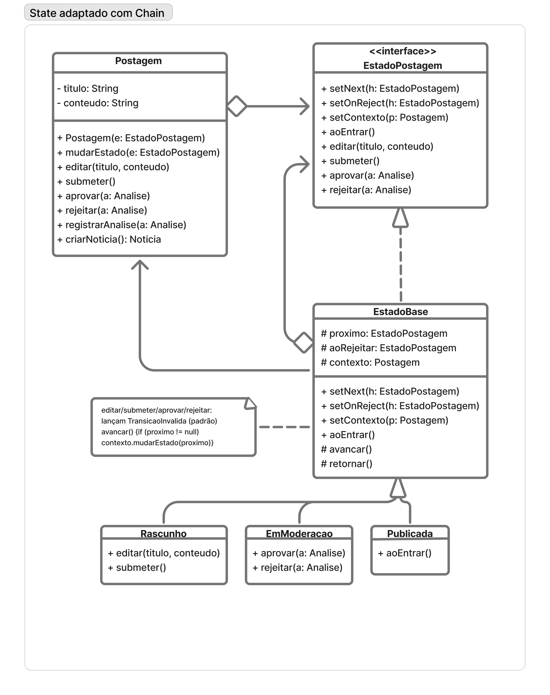

# SubEquipe_02

O relatório contém a estrutura de foco definida para a Entrega 3, além de participantes, metodologia, modelagem, implementação, versionamentos e referências.

## Foco do Relatório

### FOCO_01: GoFs Comportamentais e IA Generativa

**Entrega mínima:** três padrões comportamentais aplicados a problemas reais do Portal de Notícias Burburinho, com modelagem UML, código e vídeo demonstrando cada padrão em execução. O foco também registra as lições aprendidas e o ponto de vista crítico de cada integrante sobre o uso de IA generativa.

O subgrupo não tratará os três padrões como uma única solução. Cada integrante será responsável por um padrão principal, por um cenário específico e por evidências individuais. A integração ocorrerá no relatório e na revisão coletiva, preservando a separação das responsabilidades.

### Participantes no Foco_01

| Nome do Membro | Padrão e lições aprendidas | Uso da IA Generativa (SENSO CRÍTICO) |
|---|---|---|
| Luís Felipe Parreira Cunha | **State combinado com Chain of Responsibility:** o State representa a etapa do ciclo de publicação; a Chain encaminha validações e responsabilidades específicas de cada etapa. A combinação reduz condicionais concentradas no fluxo principal, mas exige deixar claro que se trata de uma adaptação, e não de um novo padrão GoF. | A IA foi utilizada para comparar alternativas e gerar um rascunho de modelagem. O subgrupo precisa validar os participantes, transições e responsabilidades, corrigindo qualquer elemento genérico ou incompatível com o Burburinho. |
| Matheus Eiki Kimura | **Observer:** a comunidade atua como sujeito e os membros inscritos como observadores. O padrão desacopla a mudança ocorrida na comunidade da entrega de notificações aos seus membros. | A IA será utilizada como apoio para pesquisa, modelagem e revisão. Eiki deve registrar o que foi aproveitado, corrigido ou descartado, verificando duplicidade de notificações, inscrição e remoção de observadores. |
| Pedro Henrique Ferreira Xavier | **Memento:** o histórico preserva versões do rascunho de uma postagem sem expor sua estrutura interna. O padrão separa a edição da postagem do armazenamento e da restauração de versões. | A IA será utilizada como apoio para explicar o padrão e propor uma estrutura inicial. Pedro deve validar a privacidade do estado salvo, a restauração da versão correta e a separação entre Originator, Memento e Caretaker. |

## Metodologia do Foco_01

O trabalho será realizado em ciclos:

1. **Levantamento:** revisar os artefatos da Entrega 2 e escolher um problema real para cada padrão.
2. **Modelagem individual:** cada integrante produz uma primeira versão UML, identificando participantes, responsabilidades e relações do padrão.
3. **Implementação individual:** cada integrante implementa o padrão no código do projeto ou em um exemplo executável rastreável ao domínio do Burburinho.
4. **Revisão coletiva:** o subgrupo compara UML e código, verifica se o padrão está realmente presente e corrige responsabilidades, nomes e dependências.
5. **Validação:** cada integrante executa os cenários principais e registra testes ou um roteiro reproduzível.
6. **Demonstração:** cada integrante grava um vídeo curto mostrando o padrão funcionando.
7. **Consolidação:** Luís revisa a integração documental; Eiki confere links e evidências do Observer; Pedro confere a consistência entre UML, código e vídeo do Memento.

As reuniões, decisões, revisões e eventuais alterações devem ser registradas em atas, vídeos ou commits. A IA generativa será apoio para pesquisa, comparação, geração de rascunhos e revisão, mas nenhuma sugestão será considerada evidência final sem análise humana e execução.

**Rastros metodológicos:**

- Atas ou vídeos das reuniões: **[inserir link]**
- Checklist de revisão coletiva: **[inserir link ou registrar no commit]**
- Discussões e decisões sobre os padrões: **[inserir link]**

## GoF Comportamental 1 — State combinado com Chain of Responsibility

### Contexto (Problema)

Uma postagem passa por diferentes etapas, como rascunho, enviada, em análise, ajustes necessários, aprovada, rejeitada, em produção e publicada. Sem uma separação adequada, o controlador concentra condicionais para verificar o estado atual e decidir qual responsabilidade deve ser executada.

O State permite que o comportamento da postagem varie conforme seu estado atual. A Chain of Responsibility complementa a solução encaminhando validações e responsabilidades para handlers específicos. A adaptação foi escolhida porque cada etapa do ciclo pode possuir regras próprias, sem fazer o contexto conhecer toda a lógica de validação.

### Modelagem (Notação UML)

O diagrama final foi revisado para representar o ciclo da sugestão de pauta e a distribuição das responsabilidades:

<figure style="text-align: center;">
    
    <figcaption>
Figura 1: Diagrama final do State combinado com Chain of Responsibility. Fonte: Luís Felipe, 2026.
</figcaption>
</figure>

O primeiro diagrama foi produzido com apoio de IA e é mantido como evidência do processo de revisão:

<figure style="text-align: center;">
    
    <figcaption>
Figura 2: Rascunho inicial produzido com apoio de IA. Fonte: Luís Felipe, 2026.
</figcaption>
</figure>

### Implementação (Código & Vídeo com Padrão em Execução)

Na demonstração, esses pontos são verificados da seguinte forma:

| Ponto verificado | Como a implementação testa e demonstra |
|---|---|
| Contexto da postagem | A tela apresenta a notícia “Feira comunitária movimenta a Praça Central”, sua autora, localização e resumo, representando uma postagem do Portal Burburinho. |
| Estados concretos | O `Publication` inicia em `Rascunho` e pode assumir os estados `Em análise`, `Aprovada`, `Rejeitada`, `Ajustes necessários`, `Em produção` e `Publicada`. O badge da tela e o contador de transições tornam a mudança observável. |
| Transições permitidas | Os botões disponíveis são derivados do estado atual. Assim, `Rascunho` só permite submissão; `Aprovada` só permite produção; `Ajustes necessários` só permite retorno para análise; e estados finais não oferecem ações indevidas. |
| Interface dos handlers | `ValidationHandler` define `setNext` e `handle`. Cada handler concreto é criado com uma validação e pode encaminhar a postagem ao próximo elemento. |
| Ordem da Chain | `createValidationChain` conecta `ConteudoObrigatorioHandler`, `FonteHandler`, `RevisaoEditorialHandler` e `ModeracaoHandler`. O painel e o log mostram a ordem em que cada handler recebe, aprova e encaminha a postagem. |
| Delegação do State | Ao clicar em **Submeter para análise** ou **Executar Chain novamente**, o estado registra no log que delegou a responsabilidade e chama `validate`, que inicia a Chain. |
| Fluxo aprovado | A submissão executa os quatro handlers; depois, **Aprovar postagem**, **Encaminhar para produção** e **Publicar no portal** demonstram o caminho completo até `Publicada`. |
| Fluxo rejeitado | No estado `Em análise`, **Rejeitar postagem** leva a publicação para `Rejeitada`, registra a decisão e encerra as ações disponíveis até a reinicialização. |
| Retorno para ajustes | No estado `Em análise`, **Solicitar ajustes** leva a `Ajustes necessários`; **Devolver para análise** retorna a `Em análise`, permitindo continuar o fluxo. |

Esses são testes manuais guiados pela interface, adequados para a gravação do vídeo: o resultado de cada ação aparece no estado visual, no feedback e no log. A Chain desta demonstração executa o cenário válido, em que todos os handlers aprovam; a rejeição é demonstrada como uma decisão do fluxo de análise, não como uma falha automática de um handler.

**Código hospedado no repositório:** [Demonstração Next.js — State + Chain](../../../demonstracao_codigos/SubGrupo2/) · [código-fonte e roteiro](../../../demonstracao_codigos/SubGrupo2/README.md)

**Vídeo com o padrão em execução:** a demonstração Next.js deve ser iniciada com `npm install && npm run dev`; o roteiro para gravação está no [README da demonstração](../../../demonstracao_codigos/SubGrupo2/README.md).

**Roteiro mínimo de execução:** iniciar uma postagem, submetê-la para análise, observar os quatro handlers, demonstrar o fluxo aprovado até a publicação, reiniciar para demonstrar a rejeição e reiniciar novamente para demonstrar o retorno para ajustes e a nova submissão.

## GoF Comportamental 2 — Observer

### Contexto (Problema)

Quando uma comunidade sofre uma mudança relevante, seus membros podem precisar receber uma notificação. Se a comunidade conhecer diretamente cada membro ou cada canal de comunicação, a solução fica acoplada e difícil de estender.

O Observer permite que a comunidade mantenha uma lista de observadores inscritos e notifique-os quando ocorrer uma mudança. Assim, novos membros ou canais podem ser adicionados sem alterar a lógica principal da comunidade.

### Modelagem (Notação UML)

A modelagem deve apresentar, no mínimo:

- a comunidade como `Subject` ou equivalente;
- a interface `Observer`;
- os membros concretos da comunidade;
- operações de inscrição, remoção e notificação;
- a relação entre a mudança na comunidade e o envio da notificação.

**Diagrama UML:** [inserir link ou imagem do diagrama final]

**Rascunho produzido com IA, se houver:** [inserir link ou imagem]

### Implementação (Código & Vídeo com Padrão em Execução)

A implementação deve explicar:

- quem mantém a coleção de observadores;
- como um membro se inscreve e deixa de receber notificações;
- qual evento dispara a notificação;
- qual informação é enviada aos observadores;
- como são evitadas notificações duplicadas.

**Código hospedado no repositório:** [inserir link para o código e commit]

**Vídeo com o padrão em execução:** [inserir link para o vídeo]

**Roteiro mínimo de execução:** cadastrar pelo menos dois membros em uma comunidade, provocar uma alteração, demonstrar que ambos recebem a notificação, remover um membro e demonstrar que ele não recebe a notificação seguinte.

## GoF Comportamental 3 — Memento

### Contexto (Problema)

Uma postagem em rascunho pode ser editada diversas vezes antes do envio. Sem um histórico, o usuário não consegue recuperar uma versão anterior sem duplicar a lógica de cópia no controlador ou expor detalhes internos da postagem.

O Memento permite capturar o estado necessário do rascunho e restaurá-lo posteriormente. O `Originator` cria e restaura o estado, o `Memento` armazena a fotografia do estado e o `Caretaker` gerencia o histórico sem modificar seu conteúdo.

### Modelagem (Notação UML)

A modelagem deve apresentar, no mínimo:

- a postagem ou rascunho como `Originator`;
- o objeto de estado salvo como `Memento`;
- o histórico como `Caretaker`;
- as operações para salvar e restaurar uma versão;
- a restrição de que o Caretaker não altera o conteúdo interno do Memento.

**Diagrama UML:** [inserir link ou imagem do diagrama final]

**Rascunho produzido com IA, se houver:** [inserir link ou imagem]

### Implementação (Código & Vídeo com Padrão em Execução)

A implementação deve explicar:

- quais atributos do rascunho são capturados;
- como uma versão é criada;
- como o Caretaker armazena as versões;
- como uma versão específica é restaurada;
- como a restauração evita publicar ou alterar diretamente o histórico.

**Código hospedado no repositório:** [inserir link para o código e commit]

**Vídeo com o padrão em execução:** [inserir link para o vídeo]

**Roteiro mínimo de execução:** criar um rascunho, salvar uma primeira versão, alterar o título ou conteúdo, salvar uma segunda versão, modificar novamente e restaurar a versão anterior.

## Versionamentos

| Nome do membro | Contribuição | Data |
|---|---|---|
| Luís Felipe Parreira Cunha | Elaboração da adaptação State + Chain of Responsibility, incluindo modelagem UML, revisão do rascunho com IA, código, execução, vídeo, ponto de vista crítico e revisão documental | 17/10/2026 |
| Matheus Eiki Kimura | Elaboração do GoF comportamental Observer, incluindo modelagem UML, código, execução, vídeo e ponto de vista crítico sobre o uso de IA | A preencher |
| Pedro Henrique Ferreira Xavier | Elaboração do GoF comportamental Memento, incluindo modelagem UML, código, execução, vídeo e ponto de vista crítico sobre o uso de IA | A preencher |

## Referências

- GAMMA, Erich et al. *Design Patterns: Elements of Reusable Object-Oriented Software*. Addison-Wesley.
- Documentação e materiais da disciplina sobre padrões comportamentais e modelagem UML.
- Modelo estático, diagramas de comunicação e demais artefatos da Entrega 2 do Portal de Notícias Burburinho.
- Repositório do projeto: [inserir link para o repositório]
- REFACTORING.GURU. Padrões de projeto comportamentais. Disponível em: https://refactoring.guru/pt-br/design-patterns/behavioral-patterns. Acesso em: 18 out. 2026.
