# SubEquipe_03
O relatório deverá conter a estrutura de focos estabelecida a seguir, bem como versionamentos, metodologia e participantes por foco.
Não omitir tópicos.

## Focos do Relatório:
### FOCO_03: GoFs Estruturais & IA Generativa
Entrega Mínima: um GoF Estrutural (modelo & código & vídeo com o padrão em execução).
### Participantes no Foco_03

| Nome do Membro | Lições Aprendidas | Uso da IA Generativa (SENSO CRÍTICO) |
| --- | --- | --- |
| Giovanna Aguiar | Aplicar o Decorator, do GoF estrutural, me ajudou a entender como a composição de objetos permite acrescentar responsabilidades sem encher a classe base de variações. Na Home do portal, separar paleta, banner, textos, enfeites e animação deixou claro por que o contrato comum, a delegação e a responsabilidade única importam. Também percebi que o padrão precisa se justificar pelo problema: cada classe e camada nova aumenta a complexidade. | Usei IA generativa como apoio para entender o Decorator, analisar o diagrama, implementar e documentar. Revisei as sugestões com base nos materiais da professora e pedi ajustes na separação das responsabilidades e na forma de apresentar o padrão. O detalhamento desse processo, das decisões e dos registros das conversas está em **Artefatos individuais**, na seção **Uso da IA generativa e análise crítica**. |
| Johnnatan Salles | A aplicação do padrão Decorator no ecossistema da Home do portal evidenciou como a delegação permite estender o comportamento visual sem acoplamento nem modificação da classe base (`PaginaBasePortal`). Ao atuar especificamente na substituição dinâmica da identidade visual (logos em SVG para os temas Natal, Halloween e Dia do Estudante), compreendi na prática a aderência ao princípio Aberto/Fechado (OCP): novos elementos comemorativos e marcas sazonais podem ser plugados através dos decoradores de tema (`Tema*Decorator`) sem que o componente central precise gerenciar caminhos ou regras de cada evento. | A IA generativa atuou como ferramenta auxiliar no desenho vetorial e na concepção dos arquivos SVG das logos personalizadas do Burburinho, além de auxiliar no planejamento do fluxo de substituição dos assets durante a renderização do Decorator. Como senso crítico, avaliei e refinei manualmente o código SVG gerado para evitar sobrecarga de nós e garantir alinhamento estilístico com o mascote e a tipografia do portal, além de assegurar que a substituição de marcas no decorador não violasse o contrato de renderização nem adicionasse acoplamento desnecessário à cadeia de decorators. Mais detalhes na seção **Artefatos individuais**. |
| Júlia Gabriella | A evolução incremental do GoF estrutural Decorator me permitiu compreender que a extensibilidade de uma interface não se limita à alteração de sua aparência. A partir da Home já adaptada às datas comemorativas, identifiquei a oportunidade de acrescentar responsabilidades relacionadas à apresentação e ao destaque de conteúdos, sem concentrar novas regras na classe `PaginaBasePortal`. Desenvolvi decoradores para inserir notícias relacionadas à data no topo da página e para evidenciar notícias compatíveis com os interesses do usuário, permitindo a combinação desses destaques com os temas comemorativos. Essa experiência aprofundou minha compreensão sobre composição de objetos, contrato comum, delegação e separação de responsabilidades, conceitos centrais à aplicação do Decorator. Também percebi que os princípios de responsabilidade única e Aberto/Fechado precisam orientar as decisões de modelagem, e não apenas justificar o resultado visual. A verificação das camadas isoladamente e em conjunto mostrou a importância de preservar o conteúdo original, evitar interferências entre os decoradores e avaliar se a flexibilidade obtida justifica a complexidade adicionada. | Utilizei a IA generativa desde o planejamento da minha proposta, inicialmente para comparar padrões GoF e avaliar a adequação do Decorator à extensão da Home existente, antes mesmo da definição do trabalho incremental. A ideia inicial concentrava-se em destaques visuais, mas foi refinada durante as discussões até resultar em duas responsabilidades distintas: o `DestaqueComemorativoDecorator`, que apresenta notícias relacionadas à data selecionada no topo da página, e o `DestaqueInteresseUsuarioDecorator`, que evidencia notícias associadas aos interesses do usuário. A ferramenta também auxiliou na estruturação do diagrama UML, na análise de como integrar os novos decoradores à arquitetura já desenvolvida pelos colegas e no refinamento do código e dos testes. Avaliei criticamente as sugestões, pois algumas alternativas não representavam fielmente a composição existente ou introduziam complexidade desnecessária. Confrontei as propostas com os conceitos de delegação, composição e separação de responsabilidades estudados na disciplina, além dos resultados da execução e dos testes. Dessa forma, a IA contribuiu para o amadurecimento das ideias e para a comparação de soluções, enquanto as decisões de modelagem e integração foram tomadas a partir dessa análise crítica. |

### Metodologia do Foco_03

O trabalho da SubEquipe 03 foi desenvolvido de maneira evolutiva e incremental, com cada integrante ampliando a versão funcional produzida na etapa anterior. Em vez de construir três demonstrações independentes, a equipe trabalhou sobre a mesma Home do portal Burburinho, preservando a arquitetura existente e incorporando novas responsabilidades por meio do padrão Decorator.

| Etapa | Integrante | Contribuição para a solução |
| --- | --- | --- |
| 1. Estruturação inicial | Giovanna Aguiar | Implementou a base do Decorator e a personalização da Home para Natal, Halloween e Dia do Estudante, separando paleta, banners, textos, enfeites e animação em camadas de responsabilidade específica. |
| 2. Evolução da identidade visual | Johnnatan Salles | Acrescentou logos SVG temáticas à solução existente, integrando a substituição da marca aos decoradores de cada tema, sem transferir essa responsabilidade para a página base. |
| 3. Evolução dos conteúdos | Júlia Gabriella | Acrescentou os decoradores de notícias comemorativas e de destaque por interesse do usuário, integrando as novas funcionalidades aos temas já implementados. |

A etapa final reuniu essas contribuições em uma única composição de objetos. Os destaques de notícias podem coexistir com a identidade visual comemorativa e receber a ambientação do tema selecionado, enquanto a Home mantém sua estrutura principal. Essa integração exigiu atenção à ordem de aplicação dos decoradores, à preservação do conteúdo original e à compatibilidade com o contrato de renderização. A solução foi verificada por meio da execução da aplicação e de testes automatizados. Como o produto final resulta dos três incrementos, a apresentação geral documenta a arquitetura consolidada, enquanto os artefatos individuais detalham as decisões e implementações de cada participante.

### GoF Estrutural: Decorator

#### Contexto (Problema)

A Home do portal de notícias Burburinho precisava admitir personalizações para datas comemorativas e diferentes maneiras de evidenciar conteúdos, preservando a navegação e a estrutura já existentes. No cenário desenvolvido pela equipe, a interface pode apresentar temas de Natal, Halloween e Dia do Estudante, adaptar sua identidade visual e destacar notícias relacionadas à data ou aos interesses do usuário.

O desafio arquitetural era incorporar essas variações sem concentrar regras de temas, logos e destaques na classe `PaginaBasePortal`. Uma implementação baseada em condicionais diretamente na página principal dificultaria a separação das responsabilidades e exigiria alterações recorrentes sempre que uma nova personalização fosse adicionada.

A escolha do GoF estrutural **Decorator** permitiu preservar a página base e acrescentar comportamentos por composição. Todas as camadas compartilham a operação `renderizar()`, enquanto cada decorador envolve o componente anterior e adiciona sua responsabilidade. A solução evoluiu primeiro pela personalização visual da página, depois pela adaptação da marca e, por fim, pela inclusão de novos comportamentos de destaque de notícias. Com isso, a equipe demonstrou que o padrão não se restringe a mudanças estéticas, pois também pode estender a apresentação dos conteúdos sem deslocar essas regras para o componente base.

A composição exige, contudo, cuidado com a ordem das camadas e com as alterações feitas sobre o HTML renderizado. Por esse motivo, a implementação integrada também foi examinada por meio de testes de comportamento e da execução dos diferentes cenários de personalização.

#### Modelagem (Notação UML)

O diagrama UML geral representa a arquitetura consolidada da solução após a integração das três contribuições. `PaginaPortal` permanece como contrato comum, `PaginaBasePortal` atua como componente concreto e `PaginaPortalDecorator` concentra a delegação para os decoradores concretos. Os decoradores `TextosFestivosDecorator`, `BannerFestivoDecorator`, `EnfeitesBordaDecorator` e `AnimacaoFestivaDecorator` aplicam os efeitos comemorativos, enquanto `TemaNatalDecorator`, `TemaHalloweenDecorator` e `TemaDiaEstudanteDecorator` definem as paletas e a substituição das logos temáticas. Já `DestaqueComemorativoDecorator` e `DestaqueInteresseUsuarioDecorator` ampliam a apresentação dos conteúdos sem alterar a responsabilidade central da página base.

<figure style="display: block; width: 100%; max-width: none; margin: 1.5rem auto; text-align: center;">
    <a href="../../../assets/subGrupo3/DiagramaUML_Geral.png" target="_blank" rel="noopener noreferrer" title="Abrir diagrama em tamanho maior" style="display: block; width: 100%;">
        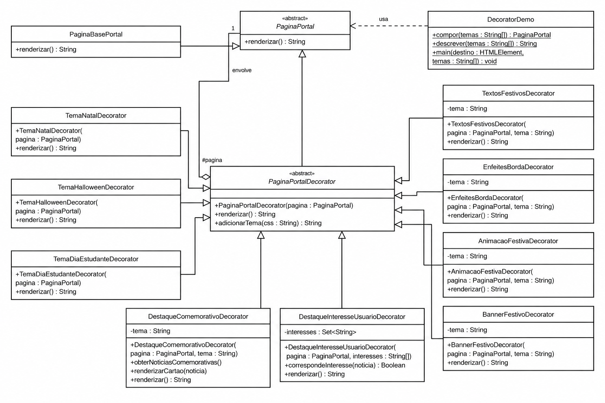
    </a>
    <figcaption style="display: block; width: 100%; max-width: none; margin: 0.75rem auto 0; text-align: center;">Figura 1: Diagrama UML geral da solução integrada com o padrão Decorator. Fonte: SubEquipe 03, 2026.</figcaption>
</figure>

O cliente `DecoratorDemo` compõe a cadeia de objetos a partir da seleção feita na interface. Os decoradores de destaque também herdam de `PaginaPortalDecorator`, pois acrescentam responsabilidades à renderização mantendo o mesmo contrato `renderizar()`. Essa organização é coerente com a estrutura apresentada na disciplina para o padrão Decorator, em que novas funcionalidades são adicionadas por composição e por delegação sucessiva ao componente envolvido.

#### Implementação (Código & Vídeo com Padrão em Execução)

??? note "Código-fonte: Decorator"

    A implementação integrada utiliza JavaScript com módulos ES, HTML e CSS. A demonstração está organizada na pasta `demonstracao_codigos/SubGrupo3/decorator/` do projeto, correspondente à pasta `decorator/` do material analisado. A aplicação não depende de frameworks nem de serviços externos.

    **Código-fonte:** [Acessar implementação do padrão Decorator no GitHub](https://github.com/UnBArqDsw2026-2-Turma01/2026.2-T01-_G3_ProjetoPortalNoticias_Entrega_03/tree/feat/relatorio-gi/demonstracao_codigos/SubGrupo3/decorator)

    **Organização da implementação**

    | Participante do padrão | Classe ou arquivo | Responsabilidade |
    | --- | --- | --- |
    | Component | `js/decorator/PaginaPortal.js` | Define o contrato comum `renderizar()` para a página e os decoradores. |
    | ConcreteComponent | `js/decorator/PaginaBasePortal.js` | Fornece a Home original, utilizando `renderizarHome()` sem conhecer as personalizações. |
    | Decorator | `js/decorator/PaginaPortalDecorator.js` | Armazena o objeto envolvido e delega a operação `renderizar()`. |
    | ConcreteDecorators de apresentação | `TextosFestivosDecorator.js`, `BannerFestivoDecorator.js`, `EnfeitesBordaDecorator.js` e `AnimacaoFestivaDecorator.js` | Aplicam separadamente os textos, o banner, os enfeites e as animações da data selecionada. |
    | ConcreteDecorators de identidade visual | `TemaNatalDecorator.js`, `TemaHalloweenDecorator.js` e `TemaDiaEstudanteDecorator.js` | Aplicam a paleta do tema e substituem a logo padrão pelo arquivo SVG correspondente. |
    | ConcreteDecorator de conteúdo comemorativo | `DestaqueComemorativoDecorator.js` | Insere no início da listagem as três notícias associadas à data selecionada, preservando os cards originais. |
    | ConcreteDecorator de interesse | `DestaqueInteresseUsuarioDecorator.js` | Identifica notícias compatíveis com os interesses configurados e acrescenta a sinalização de destaque aos cards correspondentes. |
    | Client | `js/DecoratorDemo.js` | Monta a cadeia de decoradores conforme o tema e as opções de destaque. |

    Os arquivos `js/home/renderizarHome.js`, `js/home/noticias.js`, `js/home/usuario.js` e `js/decorator/temas.js` fornecem a estrutura da Home e os dados utilizados pela demonstração. A interface de seleção está em `index.html`, com a interação controlada por `js/cliente.js`. Os testes estão em `tests/decorator.test.mjs`.

    **Trechos de código e explicação**

    Os exemplos a seguir representam o funcionamento coletivo do padrão, sem reproduzir a implementação completa de cada integrante. O foco está nas responsabilidades acrescentadas e na integração entre elas. O detalhamento de cada contribuição fica nos artefatos individuais.

    **1. Contrato e delegação da renderização**

    A interface é representada pela classe base `PaginaPortal`, que define a operação `renderizar()`. O decorador abstrato `PaginaPortalDecorator` mantém a referência para a página recebida e delega a execução. Assim, cada decorador concreto pode envolver a página base ou outro decorador.

    ```javascript
    // PaginaPortalDecorator.js
    renderizar() {
      return this.pagina.renderizar();
    }
    ```

    **2. Temas e integração da identidade visual**

    Os decoradores `TextosFestivosDecorator`, `BannerFestivoDecorator`, `EnfeitesBordaDecorator` e `AnimacaoFestivaDecorator` acrescentam efeitos comemorativos em responsabilidades separadas. Nos decoradores de tema (`Tema*Decorator`), a troca da logo SVG foi integrada à definição da paleta de cores. O trecho abaixo, extraído de `TemaNatalDecorator.js`, evidencia essas duas responsabilidades na mesma classe, sem alterar `PaginaBasePortal`.

    ```javascript
    return this.adicionarTema('--destaque:#ba303b;--barra:#173b31;--fundo:#fffaf3;--cartao:#fffdf8;--texto:#172d25;--borda:#cfa85b;--suave:#52645a;')
        .replace('LogoBurburinho.svg', 'BurburinhoNatal.svg');
    ```

    Os demais temas seguem a mesma estratégia, cada um com sua paleta e logo. Como a marca faz parte da identidade do tema selecionado, sua substituição ocorre junto com a aplicação do respectivo `Tema*Decorator`, sem exigir uma opção adicional no painel.

    **3. Inclusão de notícias da data comemorativa**

    O `DestaqueComemorativoDecorator` acrescenta à Home as notícias correspondentes ao tema ativo. O método `renderizar()` recupera o HTML existente e insere os novos cards no início da listagem, preservando os conteúdos anteriores. Essa funcionalidade é opcional e depende da seleção de um tema.

    ```javascript
    // Trecho de DestaqueComemorativoDecorator.renderizar()
    const html = super.renderizar();
    const noticias = this.obterNoticiasComemorativas();
    if (!noticias.length || !html.includes('<div class="noticias">')) return html;
    return html.replace('<div class="noticias">',
      `<div class="noticias">${noticias.map(n => this.renderizarCartao(n)).join('')}`);
    ```

    **4. Destaque conforme os interesses do usuário**

    O `DestaqueInteresseUsuarioDecorator` consulta as notícias da página renderizada e verifica a correspondência com os interesses configurados, considerando categoria e tags. Nos cards compatíveis, acrescenta a classe visual `noticia-interesse` e o selo **Para você**, sem criar uma segunda cópia da notícia. O trecho mostra a alteração após a verificação da correspondência.

    ```javascript
    // Trecho de DestaqueInteresseUsuarioDecorator.renderizar()
    const noticia = mapa.get(id);
    if (!noticia || !this.correspondeInteresse(noticia)) return cartao;
    const novaAbertura = abertura.replace(/class="([^"]+)"/,
      (_, classes) => `class="${classes} noticia-interesse"`);
    const novoConteudo = conteudo.replace('<h3>',
      '<span class="selo-interesse">Para você</span><h3>');
    return `${novaAbertura}${novoConteudo}${fechamento}`;
    ```

    **5. Composição final das contribuições**

    O cliente `DecoratorDemo` combina as funcionalidades a partir de uma única instância de `PaginaBasePortal`. As notícias comemorativas entram primeiro, para que o decorador de interesses também consiga avaliar os novos cards. Em seguida são aplicadas as camadas do tema, que envolvem a composição existente e adaptam a apresentação visual do conjunto.

    ```javascript
    // DecoratorDemo.js
    static compor(temas = [], { destaqueInteresse = false, destaqueComemorativo = false } = {}) {
      let pagina = new PaginaBasePortal();
      const tema = temas.find(t => paletas[t]);
      if (destaqueComemorativo && tema)
        pagina = new DestaqueComemorativoDecorator(pagina, tema);
      // Camada exterior vê inclusive os cartões adicionados pela camada interior.
      if (destaqueInteresse)
        pagina = new DestaqueInteresseUsuarioDecorator(pagina);
      for (const t of temas.filter(t => paletas[t]))
        for (const Camada of camadas(t)) pagina = new Camada(pagina, t);
      return pagina;
    }
    ```

    A função `camadas(tema)` reúne os decoradores de textos, enfeites, animação, banner e a paleta correspondente. Na interface de demonstração, o usuário seleciona um único tema por vez e pode ativar ou desativar os destaques. O destaque por interesse também funciona na Home padrão. Quando ambos os destaques estão ativos, as notícias comemorativas aparecem antes das seis notícias originais e também podem receber o selo **Para você**. Dessa forma, a documentação geral evidencia a integração, enquanto cada artefato individual apresenta as decisões e os detalhes do código de seu responsável.

    **Como executar**

    A aplicação utiliza módulos JavaScript, HTML e CSS, sem dependências de frameworks ou bibliotecas adicionais. É necessário ter um navegador moderno e Python 3 para executar um servidor HTTP local. Para os testes automatizados, também são necessários Node.js e npm. Não é preciso executar `npm install`, pois o projeto não declara dependências externas.

    Em qualquer sistema, abrir o terminal na pasta `demonstracao_codigos/SubGrupo3/decorator/` do repositório e iniciar o servidor com o comando correspondente.

    **Windows (PowerShell ou Prompt de Comando)**

    ```powershell
    py -3 -m http.server 5173 --bind 127.0.0.1
    ```

    Caso o iniciador `py` não esteja disponível, utilizar `python` no lugar de `py -3`, desde que esteja configurado para Python 3.

    **Linux**

    ```bash
    python3 -m http.server 5173 --bind 127.0.0.1
    ```

    No Linux, também é possível executar `npm run dev`, porque esse script utiliza `python3` no `package.json`. Não é necessário usar esse script no Windows.

    Após iniciar o servidor, abrir `http://127.0.0.1:5173` no navegador. Para encerrar o servidor, pressionar `Ctrl+C` no terminal.

    **Testes automatizados (Windows e Linux)**

    Com o terminal na mesma pasta e Node.js instalado:

    ```bash
    npm test
    ```

    Se o ambiente Windows não reconhecer o padrão de arquivo usado pelo script de testes, executar diretamente:

    ```bash
    node --test tests/decorator.test.mjs
    ```

    Na versão do código analisada, os 15 testes automatizados passaram no ambiente de validação. Foram verificados o contrato de renderização, a aplicação dos temas, a preservação do conteúdo original, a inserção das notícias no topo, os destaques por interesse e a composição das funcionalidades. Os comandos para Windows e Linux são apresentados conforme a configuração da aplicação, mas a validação automatizada foi realizada no ambiente disponível para esta análise.

??? note "Vídeo: Decorator em execução"

    A demonstração geral apresenta a Home do Burburinho em funcionamento com a composição completa do padrão Decorator. O vídeo mostra a alternância entre o modo padrão e os temas comemorativos, a ativação dos dois destaques opcionais e a combinação entre notícias comemorativas e notícias de interesse.

    <div style="position: relative; width: 100%; padding-bottom: 56.25%; height: 0; overflow: hidden; border-radius: 8px; margin: 1rem auto;">
        <iframe src="https://drive.google.com/file/d/1MHXdhRJXQQrJZxcCkNfNel2oc3VLcSLa/preview" title="Demonstração geral do padrão Decorator no portal Burburinho" loading="lazy" allow="autoplay; fullscreen" allowfullscreen style="position: absolute; inset: 0; width: 100%; height: 100%; border: 0;"></iframe>
    </div>

    <p style="text-align: center;"><a href="https://drive.google.com/file/d/1MHXdhRJXQQrJZxcCkNfNel2oc3VLcSLa/view?usp=sharing" target="_blank" rel="noopener noreferrer">Abrir a demonstração geral no Google Drive</a></p>

    **Demonstração:** A execução evidencia a montagem incremental da solução. A página base é recomposta a cada interação, podendo receber um dos temas comemorativos, a identidade visual correspondente, o destaque por interesse do usuário, o acréscimo de notícias específicas da data ou a combinação dessas responsabilidades em uma única cadeia de decoradores.

#### Artefatos individuais

??? note decorator-relatorio "Giovanna Aguiar — Gof Estrutural"

    Na minha parte do projeto, escolhi o padrão GoF estrutural **Decorator** para personalizar a Home do Burburinho com temas comemorativos. A ideia é combinar cores, banners e outros efeitos sem precisar alterar a classe que monta a página base.

    ### Introdução ao padrão

    O Decorator permite acrescentar funcionalidades a um objeto envolvendo-o em outros objetos, chamados decoradores. Todos seguem o mesmo contrato. Assim, o código que utiliza a página pode chamar `renderizar()` tanto na página base quanto em uma página decorada. Cada decorador chama a renderização do objeto que recebeu e acrescenta seu efeito.

    Um decorador também pode receber outro decorador, combinando responsabilidades no mesmo objeto. Nesta demonstração, essa composição é feita pelo código: ao escolher uma data, o painel aplica uma combinação pronta de cinco decoradores. Os efeitos não são ativados individualmente pelo usuário.

    ### Contexto (Problema)

    Para demonstrar o padrão, usei três temas na Home: Natal, Halloween e Dia do Estudante. A proposta foi manter as comunidades e a organização do protótipo, acrescentando os efeitos de cada data. Se todas essas regras ficassem na classe da página base, ela também teria que cuidar das particularidades de cada tema.

    Com o Decorator, a página base continua responsável pela Home, e cada efeito fica em uma classe própria. A demonstração usa notícias fictícias, com seis cards, resumos, leitura do texto e busca local.

    ### Uso da IA generativa e análise crítica

    Pedi ajuda à IA para entender melhor o Decorator e como seus participantes apareceriam no código e no diagrama da Home. Usei o protótipo, o diagrama e os slides da professora para orientar os pedidos e comparar as respostas com os exemplos da disciplina.

    Ao revisar o diagrama, percebi que alguns pontos precisavam de ajustes e pedi ajuda para conferir os papéis de Component, ConcreteComponent, Decorator e ConcreteDecorator, além das relações entre eles. Comparei as sugestões com o material da professora.

    Na primeira versão, os temas mudavam principalmente as cores, e achei que isso mostrava pouco do que eu queria demonstrar. Pedi elementos próprios de cada data, como banners, textos, enfeites e animações, com cada responsabilidade em um ConcreteDecorator. Assim, ficou mais fácil enxergar como as camadas se combinam.

    A IA também ajudou a escrever e revisar o código, adaptar a implementação para JavaScript e organizar o relatório. Ao longo desse processo, precisei pedir correções e voltar aos requisitos e ao material da disciplina. Uma tela funcionando, por si só, não mostra se o padrão foi bem aplicado. Por isso, além dos testes e da demonstração, é preciso entender as classes e as relações entre elas.

    **Registros das conversas com IA**

    - [Conversa no Claude](https://claude.ai/share/c4cac0d5-6fbf-4a21-8a00-020b3552e17b).
    - [Conversa no ChatGPT — registro 1](https://chatgpt.com/share/6ad14788-eaec-83e9-8813-57865ad93c9e).
    - [Conversa no ChatGPT — registro 2](https://chatgpt.com/share/6ad147af-a1a8-83e9-9f0b-30b9b60a0c3e).

    **Registros visuais do apoio da IA**

    Abaixo estão dois registros desse processo: as sugestões de correção do Claude e um diagrama gerado pelo ChatGPT. Clique nas imagens para ampliar.

    <figure style="text-align: center;">
        <a href="../../../assets/subGrupo3/ia-claude-revisao-diagrama.png" target="_blank" rel="noopener noreferrer">
            
        </a>
        <figcaption>Figura: Sugestões do Claude para a revisão do diagrama. Fonte: captura de tela de Giovanna Aguiar, 2026.</figcaption>
    </figure>

    <figure style="text-align: center;">
        <a href="../../../assets/subGrupo3/ia-chatgpt-diagrama-gerado.png" target="_blank" rel="noopener noreferrer">
            
        </a>
        <figcaption>Figura: Proposta de diagrama gerada pelo ChatGPT e submetida à análise. Fonte: captura de tela de Giovanna Aguiar, 2026.</figcaption>
    </figure>

    ### Aplicação

    A classe `PaginaBasePortal` monta a Home com o usuário logado. Sobre ela, cada tema combina cinco decoradores: um para as cores, um para os textos, um para os enfeites, um para a animação e um para o banner. O código fica em `demonstracao_codigos/SubGrupo3/decorator/`, com HTML, CSS, imagens e classes JavaScript separados, seguindo a organização do Subgrupo 1. Não é necessário usar framework nem compilar o projeto.

    | Participante do padrão | Elemento no projeto | Responsabilidade |
    | --- | --- | --- |
    | Component | `PaginaPortal` | Define o contrato comum `renderizar()`, que retorna HTML. |
    | ConcreteComponent | `PaginaBasePortal` | Fornece a Home sem personalizações comemorativas. |
    | Decorator | `PaginaPortalDecorator` | Guarda a referência à página e oferece a delegação ao objeto envolvido. |
    | ConcreteDecorators | `Tema*Decorator`, `BannerFestivoDecorator`, `TextosFestivosDecorator`, `EnfeitesBordaDecorator` e `AnimacaoFestivaDecorator` | Acrescentam separadamente as cores e os efeitos da data selecionada. |
    | Client | `DecoratorDemo` | Monta a composição e apresenta o resultado na Home. |

    Ao selecionar Natal, por exemplo, o cliente combina automaticamente os decoradores de textos, enfeites, animação, banner e cores natalinas. Cada um envolve o objeto anterior e acrescenta seu efeito ao resultado de `renderizar()`. O painel troca o conjunto completo ao selecionar outra data; ele não acumula temas nem permite escolher os efeitos separadamente. Ao voltar ao Padrão, o cliente cria uma página base sem os efeitos festivos.

    Essa separação facilita acrescentar e testar cada efeito, mas também aumenta o número de classes e exige atenção à ordem das camadas. Os enfeites ficam nas margens para não atrapalhar a leitura, e as animações respeitam a configuração de movimento reduzido do sistema.

    ### Diagrama

    <figure style="display: block; width: 100%; max-width: none; margin: 1.5rem auto; text-align: center;">
        <a href="../../../assets/subGrupo3/decorator-diagrama-corrigido.png" target="_blank" rel="noopener noreferrer" title="Abrir diagrama em tamanho maior" style="display: block; width: 100%;">
            
        </a>
        <figcaption style="display: block; width: 100%; max-width: none; margin: 0.75rem auto 0; text-align: center;">Fonte: <a href="https://github.com/giovannabrito19" target="_blank" rel="noopener noreferrer">Giovanna Aguiar</a>, 2026.</figcaption>
    </figure>

    ### Trechos de código

    #### Componente

    Como JavaScript não tem interfaces nativas, usei `PaginaPortal` como uma classe base que representa o contrato: ela bloqueia a criação direta de objetos e exige a implementação de `renderizar()`. `PaginaBasePortal` segue esse contrato e monta a Home sem precisar conhecer os temas.


    ```javascript
    export class PaginaPortal {
      constructor() {
        if (new.target === PaginaPortal) {
          throw new Error('PaginaPortal é um contrato: use uma página concreta ou um decorador.');
        }
      }
      renderizar() {
        throw new Error('renderizar() deve ser implementado.');
      }
    }

    export class PaginaBasePortal extends PaginaPortal {
      renderizar() {
        return renderizarHome();
      }
    }
    ```

    #### Decorator abstrato

    `PaginaPortalDecorator` guarda o objeto recebido em `this.pagina` e delega a ele a chamada de `renderizar()`. Esse objeto pode ser a página base ou outro decorador. Nesta demonstração, o cliente combina automaticamente os cinco decoradores do tema selecionado.


    ```javascript
    export class PaginaPortalDecorator extends PaginaPortal {
      constructor(pagina) {
        super();
        if (new.target === PaginaPortalDecorator) {
          throw new Error('Use um decorador concreto.');
        }
        this.pagina = pagina;
      }

      renderizar() {
        return this.pagina.renderizar();
      }

      adicionarTema(css) {
        return `<section class="tema" style="${css}">
          ${this.pagina.renderizar()}
        </section>`;
      }
    }
    ```

    O método `adicionarTema(css)` reúne a montagem do contêiner usado pelas três paletas. Cada decorador de cores informa seus valores, reutilizando essa montagem sem repetir o mesmo HTML.

    #### ConcreteDecorator de paleta e identidade visual

    `TemaNatalDecorator` aproveita o construtor do decorador abstrato, define as cores de Natal e substitui a marca padrão pelo logo temático (`BurburinhoNatal.svg`). O método auxiliar `adicionarTema()` envolve o HTML da página com essas cores, sem precisar reescrever a Home, enquanto a substituição do ativo garante que a identidade visual comemorativa seja renderizada.


    ```javascript
    export class TemaNatalDecorator extends PaginaPortalDecorator {
        renderizar() {
            return this.adicionarTema('--destaque:#ba303b;--barra:#173b31;--fundo:#fffaf3;--cartao:#fffdf8;--texto:#172d25;--borda:#cfa85b;--suave:#52645a;')
                .replace('LogoBurburinho.svg', 'BurburinhoNatal.svg');
        }
    }
    ```

    #### ConcreteDecorator de banner

    `this.tema` é definido pelo construtor de cada decorador que precisa dos dados da data. O construtor chama `super(pagina)` para guardar o componente e salva o tema na própria instância. Banner, animação, enfeites e textos seguem essa estrutura; os decoradores de paleta já representam uma data específica.

    ```javascript
    // Construtor de BannerFestivoDecorator.
    constructor(pagina, tema) {
      super(pagina);
      this.tema = tema;
    }
    ```

    Em `BannerFestivoDecorator.renderizar()`, o tema identifica os dados do cabeçalho. `super.renderizar()` recupera o resultado do objeto envolvido. O ornamento complementar foi omitido deste trecho.


    ```javascript
    const { nome, data, simbolo, mensagem } = temas[this.tema];
    return `<div class="camada-banner">
      <header class="banner-tema" role="note">
        <span class="simbolo-banner" aria-hidden="true">${simbolo}</span>
        <div><strong>${nome} · ${data}</strong><p>${mensagem}</p></div>
      </header>
      ${super.renderizar()}
    </div>`;
    ```

    #### ConcreteDecorator de animação

    Trecho de `AnimacaoFestivaDecorator.renderizar()`: acrescenta as partículas e preserva o resultado do componente envolvido por meio de `super.renderizar()`. Essa classe cuida somente da animação; banner, textos e cores são acrescentados por outros decoradores.


    ```javascript
    const particulas = temas[this.tema].particulas.map((simbolo, indice) =>
      `<span class="particula particula-${indice}">${simbolo}</span>`,
    ).join('');
    return `<div class="camada-animada">
      <div class="particulas particulas-${this.tema}" aria-hidden="true">${particulas}</div>
      ${super.renderizar()}
    </div>`;
    ```

    #### ConcreteDecorator de textos

    Trecho de `TextosFestivosDecorator.renderizar()`: adapta a saudação e o título da seção nos espaços identificados pela Home. A mesma classe também atualiza os selos dos cards, preservando os títulos das notícias e as categorias.

    A Home identifica os espaços de personalização com atributos como `data-saudacao` e `data-titulo-secao`. O decorador usa essas marcações para atualizar os textos e é aplicado diretamente à página base, antes dos efeitos visuais. Se essas marcações mudarem, as substituições precisam acompanhar a alteração.


    ```javascript
    const { saudacao, secao, selo } = temas[this.tema];
    return super.renderizar()
      .replace(/(<h1 data-saudacao>)[^<]*(<\/h1>)/, `$1${saudacao}, ${nomeUsuario}!$2`)
      .replace(/(<h2 id="titulo-ultimas" data-titulo-secao>)[^<]*(<\/h2>)/, `$1${secao}$2`)
      // As substituições dos selos continuam no arquivo completo.
    ```

    #### Definição das camadas

    A função `camadas(tema)` define a combinação pronta usada em cada seleção do painel. Ela escolhe a classe de cores da data e inclui os quatro decoradores de textos, enfeites, animação e banner. Esses quatro recebem a data como configuração.


    ```javascript
    const paletas = {
      natal: TemaNatalDecorator,
      halloween: TemaHalloweenDecorator,
      estudante: TemaDiaEstudanteDecorator,
    };
    const camadas = (tema) => [
      TextosFestivosDecorator, EnfeitesBordaDecorator, AnimacaoFestivaDecorator,
      BannerFestivoDecorator, paletas[tema],
    ];
    ```

    #### Uso na Home

    O cliente começa com a página base e a envolve com os decoradores do tema escolhido. No fim, chama `renderizar()` para mostrar o resultado na Home. O painel permite alternar os temas durante a demonstração e voltar ao Padrão. Em um portal em produção, essa escolha poderia ser feita pelo calendário ou por uma configuração administrativa, usando os mesmos decoradores.


    O painel envia a data selecionada em um array `temas` com um único item. Ao escolher Padrão, envia um array vazio. Assim, o loop combina automaticamente os cinco efeitos da data escolhida e cada troca começa com uma nova página base.

    ```javascript
    let pagina = new PaginaBasePortal();
    for (const tema of temas) {
      for (const Camada of camadas(tema)) pagina = new Camada(pagina, tema);
    }
    // Em DecoratorDemo.main():
    destino.innerHTML = this.compor(temas).renderizar();
    ```

    ### Vídeo: Decorator em execução

    Gravação da demonstração da Home com os temas comemorativos, anterior à migração para JavaScript e à ampliação das notícias. O vídeo registra os mesmos efeitos festivos, mas os textos das notícias foram atualizados na versão atual. A reprodução é automática, sem som e em loop, como um GIF; os controles permitem pausar e avançar.

    <video autoplay loop muted playsinline controls preload="metadata" poster="../../../assets/subGrupo3/decorator-demo-natal.jpg" style="display: block; width: 100%; height: auto; border-radius: 8px;" aria-label="Demonstração do padrão Decorator nos temas da Home do Burburinho">
        <source src="../../../assets/subGrupo3/decorator-demonstracao.mp4" type="video/mp4">
        Seu navegador não reproduz este vídeo. Use o link abaixo para abrir a gravação.
    </video>

    <p style="text-align: center;">
        <a href="../../../assets/subGrupo3/decorator-demonstracao.mp4" target="_blank" rel="noopener noreferrer">Abrir a demonstração em outra aba</a>
    </p>

    **Demonstração complementar pelo Google Drive**

    <div style="position: relative; width: 100%; padding-bottom: 56.25%; height: 0; overflow: hidden; border-radius: 8px; margin: 1rem auto;">
        <iframe src="https://drive.google.com/file/d/1BK8yQtp9BAzRKOVL5HMhS5UkdWBqu8qK/preview" title="Demonstração complementar de Giovanna sobre os temas comemorativos" loading="lazy" allow="autoplay; fullscreen" allowfullscreen style="position: absolute; inset: 0; width: 100%; height: 100%; border: 0;"></iframe>
    </div>

    <p style="text-align: center;"><a href="https://drive.google.com/file/d/1BK8yQtp9BAzRKOVL5HMhS5UkdWBqu8qK/view?usp=sharing" target="_blank" rel="noopener noreferrer">Abrir a demonstração complementar de Giovanna no Google Drive</a></p>

    ### Referências

    - SERRANO, Milene. *Arquitetura e Desenho de Software — Aula GoFs Estruturais*. UnB. Slides 59–60.
    - GAMMA, Erich et al. *Design Patterns: Elements of Reusable Object-Oriented Software*. Addison-Wesley, 1995. Decorator.
    - [SourceMaking — Decorator](https://sourcemaking.com/design_patterns/decorator/java/1).

??? note decorator-relatorio-johnnatan "Johnnatan Salles — Gof Estrutural: Renderização Dinâmica de Logos com Decorator"

    Na minha contribuição ao projeto e ao padrão **Decorator**, atuei na extensão visual comemorativa do portal Burburinho, tornando a renderização das marcas/logos dinâmica conforme o evento selecionado (Natal, Halloween e Dia do Estudante), preservando o encapsulamento e o princípio Aberto/Fechado (*Open/Closed Principle*).

    ### Contexto e Problema

    A Home do portal possui uma marca principal na barra lateral (`sidebar`), originalmente referenciada como uma imagem estática (`marca.png`). Ao aplicarmos o padrão Decorator para os temas comemorativos, além de adaptar a paleta de cores, banners, enfeites e textos, surgiu a necessidade de estender a própria identidade visual do portal — o sapo mascote e a tipografia do Burburinho — para refletir o evento temático.

    Se essa lógica de troca de marca fosse tratada de forma condicional (`if/else` ou `switch`) na classe base `PaginaBasePortal` ou diretamente no componente de montagem da Home, violaríamos o princípio de responsabilidade única e o OCP: a cada nova data festiva criada, a classe base precisaria ser alterada para conhecer os novos caminhos e regras visuais do evento.

    ### Solução com Decorator

    A solução adotada foi manter a classe base (`PaginaBasePortal`) renderizando a marca base neutra vetorizada em SVG (`LogoBurburinho.svg`). A responsabilidade de alternar a identidade visual comemorativa foi incorporada aos decoradores concretos de cada evento (`TemaNatalDecorator`, `TemaHalloweenDecorator`, `TemaDiaEstudanteDecorator`), que estendem `PaginaPortalDecorator`.

    Ao interceptar a chamada de renderização através do método `renderizar()`, cada decorador concreto aplica tanto a estilização de cores (via `adicionarTema()`) quanto a substituição precisa do ativo SVG correspondente:
    - **Padrão (Base):** `LogoBurburinho.svg`
    - **Tema Natal:** `BurburinhoNatal.svg` (gorro de Papai Noel e adereços natalinos)
    - **Tema Halloween:** `BurburinhoHalloween.svg` (chapéu de bruxo e temática mística)
    - **Tema Dia do Estudante:** `BurburinhoEstudante.svg` (capelo de formatura e elementos acadêmicos)

    ### Participantes e Responsabilidades na Renderização das Logos

    | Participante do Padrão | Elemento no Projeto | Responsabilidade na Renderização das Logos |
    | --- | --- | --- |
    | Component | `PaginaPortal` | Contrato comum que define a operação `renderizar()`. |
    | ConcreteComponent | `PaginaBasePortal` | Renderiza a estrutura base da Home contendo a marca padrão neutra (`LogoBurburinho.svg`). |
    | Decorator | `PaginaPortalDecorator` | Classe abstrata que delega a renderização ao objeto envolvido (`this.pagina.renderizar()`). |
    | ConcreteDecorator (Natal) | `TemaNatalDecorator` | Envolve a página com as variáveis de cor de Natal e substitui a logo padrão por `BurburinhoNatal.svg`. |
    | ConcreteDecorator (Halloween) | `TemaHalloweenDecorator` | Envolve a página com as variáveis de cor de Halloween e substitui a logo padrão por `BurburinhoHalloween.svg`. |
    | ConcreteDecorator (Estudante) | `TemaDiaEstudanteDecorator` | Envolve a página com as variáveis de cor de Estudante e substitui a logo padrão por `BurburinhoEstudante.svg`. |

    ### Identidades Visuais Temáticas (Logos SVG)

    Abaixo estão as quatro variações de logos SVG desenvolvidas e utilizadas na demonstração do padrão no portal:

    <div style="display: grid; grid-template-columns: repeat(auto-fit, minmax(200px, 1fr)); gap: 16px; margin: 24px 0; text-align: center;">
      <div style="padding: 12px; background: #fff; border: 1px solid #e0e0e0; border-radius: 8px;">
        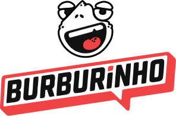
        <p style="font-size: 13px; font-weight: bold; margin-top: 8px; color: #333;">Base: LogoBurburinho.svg</p>
      </div>
      <div style="padding: 12px; background: #fffaf3; border: 1px solid #cfa85b; border-radius: 8px;">
        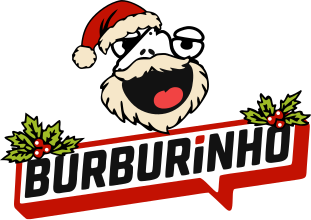
        <p style="font-size: 13px; font-weight: bold; margin-top: 8px; color: #ba303b;">Natal: BurburinhoNatal.svg</p>
      </div>
      <div style="padding: 12px; background: #f6effa; border: 1px solid #ba692f; border-radius: 8px;">
        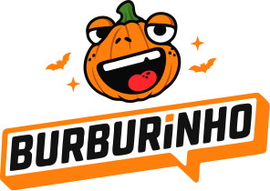
        <p style="font-size: 13px; font-weight: bold; margin-top: 8px; color: #b94708;">Halloween: BurburinhoHalloween.svg</p>
      </div>
      <div style="padding: 12px; background: #f3f7ff; border: 1px solid #dcac33; border-radius: 8px;">
        
        <p style="font-size: 13px; font-weight: bold; margin-top: 8px; color: #2457b3;">Dia do Estudante: BurburinhoEstudante.svg</p>
      </div>
    </div>

    ### Diagrama

    <figure style="display: block; width: 100%; max-width: none; margin: 1.5rem auto; text-align: center;">
        <a href="../../../assets/subGrupo3/decorator-diagrama-corrigido.png" target="_blank" rel="noopener noreferrer" title="Abrir diagrama em tamanho maior" style="display: block; width: 100%;">
            
        </a>
        <figcaption style="display: block; width: 100%; max-width: none; margin: 0.75rem auto 0; text-align: center;">Fonte: <a href="https://github.com/jsalless" target="_blank" rel="noopener noreferrer">Johnnatan Salles</a>, 2026.</figcaption>
    </figure>

    ### Implementação em Código

    #### 1. Componente Concreto Base (`renderizarHome.js`)
    A classe base insere o SVG neutro da marca na barra lateral:

    ```javascript
    export function renderizarHome() {
        return `<div class="portal-home">
        <aside class="sidebar" aria-label="Navegação do portal">
          
          ...
    ```

    #### 2. Decoradores Concretos de Tema (`Tema*Decorator.js`)
    Cada decorador concreto sobrescreve o método `renderizar()`, combinando a injeção do escopo de estilo via `adicionarTema()` e a substituição dinâmica da marca:

    ```javascript
    // TemaNatalDecorator.js
    import { PaginaPortalDecorator } from './PaginaPortalDecorator.js';

    export class TemaNatalDecorator extends PaginaPortalDecorator {
        renderizar() {
            return this.adicionarTema('--destaque:#ba303b;--barra:#173b31;--fundo:#fffaf3;--cartao:#fffdf8;--texto:#172d25;--borda:#cfa85b;--suave:#52645a;')
                .replace('LogoBurburinho.svg', 'BurburinhoNatal.svg');
        }
    }
    ```

    ```javascript
    // TemaHalloweenDecorator.js
    import { PaginaPortalDecorator } from './PaginaPortalDecorator.js';

    export class TemaHalloweenDecorator extends PaginaPortalDecorator {
        renderizar() {
            return this.adicionarTema('--destaque:#b94708;--barra:#21162d;--fundo:#f6effa;--cartao:#fffbf7;--texto:#281a34;--borda:#ba692f;--suave:#67576f;')
                .replace('LogoBurburinho.svg', 'BurburinhoHalloween.svg');
        }
    }
    ```

    ```javascript
    // TemaDiaEstudanteDecorator.js
    import { PaginaPortalDecorator } from './PaginaPortalDecorator.js';

    export class TemaDiaEstudanteDecorator extends PaginaPortalDecorator {
        renderizar() {
            return this.adicionarTema('--destaque:#2457b3;--barra:#152b4f;--fundo:#f3f7ff;--cartao:#ffffff;--texto:#162d51;--borda:#dcac33;--suave:#52645a;')
                .replace('LogoBurburinho.svg', 'BurburinhoEstudante.svg');
        }
    }
    ```

    ### Uso de IA Generativa e Análise Crítica

    No desenvolvimento desta funcionalidade, utilizei ferramentas de IA Generativa com foco em:
    1. **Geração vetorial das identidades comemorativas (SVG):** Solicitação de propostas de nós vetoriais e adereços temáticos incorporados ao mascote (chapéu de bruxo para Halloween, gorro de Natal, capelo acadêmico para o Dia do Estudante).
    2. **Validação da integração com o padrão Decorator:** Análise de alternativas sobre como estender a logo sem introduzir acoplamentos desnecessários.

    **Análise Crítica e Decisões de Design:**
    - *Avaliação dos arquivos SVG:* Os modelos gerados inicialmente por IA apresentavam nós redundantes, tags desnecessárias e viewBoxes inconsistentes que provocavam distorções visuais na barra lateral (`sidebar`). Realizei a limpeza manual dos caminhos, validação das proporções e unificação da dimensão de visualização (`viewBox="0 0 296 195"`), mantendo a perfeita fidelidade com a identidade original.
    - *Decisão arquitetural sobre a responsabilidade do Decorator:* Avaliei a criação de uma classe decoradora isolada (ex: `LogoFestivaDecorator`) versus acoplar a substituição ao `Tema*Decorator`. Concluiu-se que as logos não são elementos avulsos ou selecionáveis isoladamente pelo usuário, mas parte intrínseca da identidade do evento (assim como a paleta de cores). Mantê-la no decorador concreto de tema evitou criar camadas redundantes na cadeia de decoradores, respeitando a simplicidade e a coesão sem ferir o padrão GoF.

    ### Vídeo: Decorator em execução

    Gravação da demonstração da renderização dinâmica das logos temáticas em execução na Home do Burburinho utilizando o padrão Decorator:

    **Reprodução pelo Google Drive**

    <div style="position: relative; width: 100%; padding-bottom: 56.25%; height: 0; overflow: hidden; border-radius: 8px; margin: 1rem auto;">
        <iframe src="https://drive.google.com/file/d/1MvR9GlkYVLYqkhLvQwVGZFxjjuGHeCXS/preview" title="Demonstração de Johnnatan sobre as logos temáticas com Decorator" loading="lazy" allow="autoplay; fullscreen" allowfullscreen style="position: absolute; inset: 0; width: 100%; height: 100%; border: 0;"></iframe>
    </div>

    <p style="text-align: center;"><a href="https://drive.google.com/file/d/1MvR9GlkYVLYqkhLvQwVGZFxjjuGHeCXS/view?usp=sharing" target="_blank" rel="noopener noreferrer">Abrir o vídeo de Johnnatan no Google Drive</a></p>

    ### Referências

    - SERRANO, Milene. *Arquitetura e Desenho de Software — Aula GoFs Estruturais*. UnB. Slides 59–60.
    - GAMMA, Erich et al. *Design Patterns: Elements of Reusable Object-Oriented Software*. Addison-Wesley, 1995. Decorator.

??? note decorator-relatorio-julia "Júlia Gabriella — GoF Estrutural: Destaque de notícias comemorativas e por interesse do usuário"

    Minha contribuição consistiu na evolução incremental da Home, que já utilizava o padrão Decorator para aplicar temas comemorativos, com paletas, banners, textos, enfeites, animações e logos específicas para cada data. Em vez de criar outra página ou substituir essas funcionalidades, desenvolvi duas extensões independentes para a exibição das notícias. O objetivo foi aproveitar a composição já existente e permitir a ativação de novos comportamentos sem modificar a responsabilidade principal de `PaginaBasePortal`.

    ### Introdução e contexto do problema

    O Decorator é um padrão estrutural que permite acrescentar responsabilidades a objetos por meio da composição, mantendo um contrato comum. Na nossa aplicação, `PaginaPortal` estabelece a operação `renderizar()`, `PaginaBasePortal` fornece a Home original e `PaginaPortalDecorator` permite envolver esse resultado com novas funcionalidades. A escolha foi especialmente adequada porque a equipe já havia adotado essa estrutura para personalizações visuais.

    Ao analisar a versão existente, identifiquei duas necessidades que poderiam ser tratadas separadamente. A primeira era inserir notícias próprias da data comemorativa selecionada, em vez de apenas alterar cores, logos e ornamentos de notícias que continuavam as mesmas. A segunda era identificar, entre os conteúdos exibidos, aqueles relacionados aos interesses da pessoa usuária, independentemente de haver um tema festivo ativo.

    Essas funcionalidades não são equivalentes. O destaque comemorativo **acrescenta notícias à listagem**, enquanto o destaque por interesse **identifica visualmente notícias que já estão sendo apresentadas**. Por isso, optei por desenvolver duas classes concretas independentes, mantendo a possibilidade de combiná-las com os Decorators anteriores.

    ### Uso da IA generativa e análise crítica

    Utilizei o ChatGPT como apoio desde a fase de escolha do padrão. Antes de definir como minha contribuição seria incremental, comparei possibilidades de GoFs estruturais para o portal, incluindo Decorator, Proxy, Facade e Composite. A comparação ajudou a relacionar problemas diferentes às intenções de cada padrão. O Decorator mostrou maior aderência ao objetivo de acrescentar responsabilidades de apresentação à Home sem substituir o componente existente.

    <figure style="text-align: center; margin: 1.25rem auto;">
        <a href="../../../assets/subGrupo3/ia-chatgpt-decisãoGoFEstrutural(julia).PNG" target="_blank" rel="noopener noreferrer">
            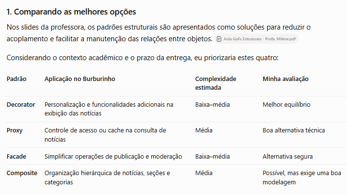
        </a>
        <figcaption>Figura: Comparação de padrões estruturais e seus usos possíveis no portal Burburinho Fonte: registro da conversa com ChatGPT de Júlia Gabriella, 2026.</figcaption>
    </figure>

    A proposta também mudou ao longo das discussões. Inicialmente, eu pensava principalmente em aplicar destaques visuais às notícias. Ao aprofundar a análise, distingui duas situações. As notícias relacionadas a uma data precisavam efetivamente integrar o conteúdo da página. Já as notícias de interesse do usuário deveriam conservar seu conteúdo original e receber apenas uma identificação de relevância. Essa separação levou à definição de `DestaqueComemorativoDecorator` e `DestaqueInteresseUsuarioDecorator`.

    A IA auxiliou na exploração da ordem das camadas, na simulação de combinações e na avaliação de como os novos Decorators poderiam coexistir com aqueles que já haviam sido implementados. As imagens seguintes registram propostas utilizadas para discutir a integração e o tratamento visual. Elas não representam, por si só, a implementação final.

    <figure style="text-align: center; margin: 1.25rem auto;">
        <a href="../../../assets/subGrupo3/ia-chatgpt-tomada_de_decisao(julia).PNG" target="_blank" rel="noopener noreferrer">
            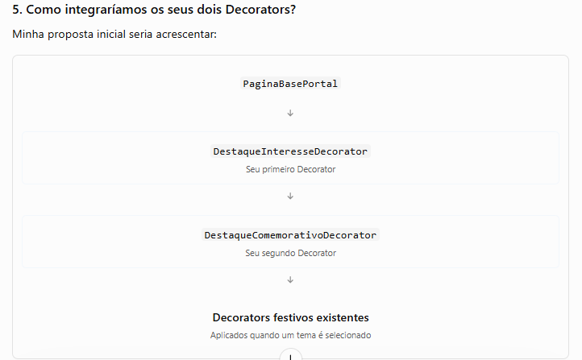
        </a>
        <figcaption>Figura: Proposta inicial de ordem de composição das funcionalidades Fonte: registro da conversa com ChatGPT de Júlia Gabriella, 2026.</figcaption>
    </figure>

    <figure style="text-align: center; margin: 1.25rem auto;">
        <a href="../../../assets/subGrupo3/ia-chatgpt-tomada_de_decisao3(julia).PNG" target="_blank" rel="noopener noreferrer">
            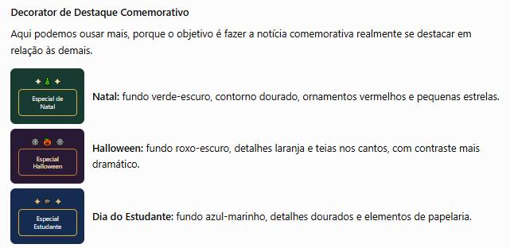
        </a>
        <figcaption>Figura: Exploração de diferentes tratamentos visuais para as notícias comemorativas Fonte: registro da conversa com ChatGPT de Júlia Gabriella, 2026.</figcaption>
    </figure>

    <figure style="text-align: center; margin: 1.25rem auto;">
        <a href="../../../assets/subGrupo3/ia-chatgpt-tomada_de_decisao2(julia).PNG" target="_blank" rel="noopener noreferrer">
            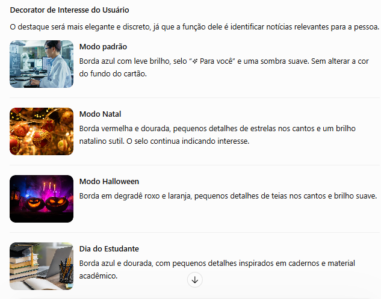
        </a>
        <figcaption>Figura: Refinamento do destaque por interesse do usuário em cada contexto visual Fonte: registro da conversa com ChatGPT de Júlia Gabriella, 2026.</figcaption>
    </figure>

    <figure style="text-align: center; margin: 1.25rem auto;">
        <a href="../../../assets/subGrupo3/ia-chatgpt-simulacaoDeIdeais(julia).PNG" target="_blank" rel="noopener noreferrer">
            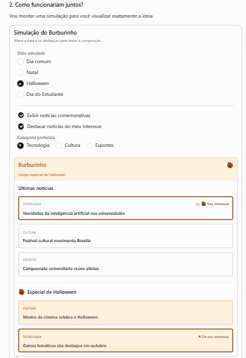
        </a>
        <figcaption>Figura: Simulação preliminar da coexistência de notícias temáticas e destaque por interesse Fonte: registro da conversa com ChatGPT de Júlia Gabriella, 2026.</figcaption>
    </figure>

    Na etapa de modelagem, solicitei sugestões de diagramas de classes e de sequência para compreender melhor os participantes e as chamadas de `renderizar()`. Essas propostas serviram como apoio ao raciocínio, mas precisaram ser revistas. Algumas utilizavam nomes, operações ou tecnologias diferentes dos adotados no código definitivo. A implementação entregue utiliza módulos JavaScript e o contrato `PaginaPortal`, com `renderizar()`, e não necessariamente as estruturas presentes nos desenhos preliminares. Por isso, os registros abaixo são evidências de exploração de alternativas, e não a UML definitiva da equipe.

    <figure style="text-align: center; margin: 1.25rem auto;">
        <a href="../../../assets/subGrupo3/ia-chatgpt-diagramaSugerido(julia).PNG" target="_blank" rel="noopener noreferrer">
            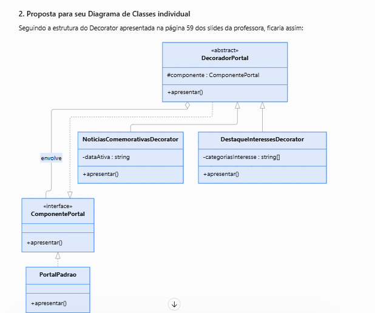
        </a>
        <figcaption>Figura: Primeira sugestão de diagrama de classes utilizada apenas para análise Fonte: registro da conversa com ChatGPT de Júlia Gabriella, 2026.</figcaption>
    </figure>

    <figure style="text-align: center; margin: 1.25rem auto;">
        <a href="../../../assets/subGrupo3/ia-chatgpt-sugestaoDiagramaAuxiliar(julia).PNG" target="_blank" rel="noopener noreferrer">
            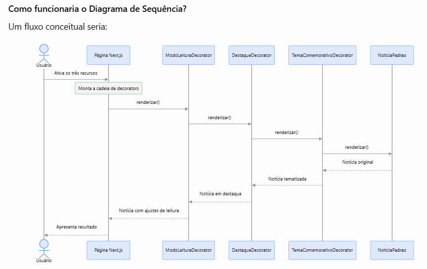
        </a>
        <figcaption>Figura: Proposta auxiliar de sequência para compreender chamadas encadeadas Fonte: registro da conversa com ChatGPT de Júlia Gabriella, 2026.</figcaption>
    </figure>

    A ferramenta também auxiliou no refinamento do código e na construção de critérios de verificação. Um exemplo foi o checklist de situações em que as funcionalidades deveriam operar juntas ou separadas. Considerei o checklist um roteiro de verificação, não uma prova automática de que a implementação estava correta. A validação efetiva foi feita a partir da leitura do código, da execução da interface e dos testes automatizados.

    <figure style="text-align: center; margin: 1.25rem auto;">
        <a href="../../../assets/subGrupo3/ia-chatgpt-checklistaSugerido(julia).PNG" target="_blank" rel="noopener noreferrer">
            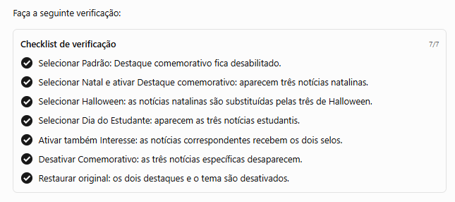
        </a>
        <figcaption>Figura: Checklist de cenários proposto pela IA para orientar a verificação funcional Fonte: registro da conversa com ChatGPT de Júlia Gabriella, 2026.</figcaption>
    </figure>

    **Registro da conversa com IA**

    - [Conversa no ChatGPT](https://chatgpt.com/share/6ad538d0-4c4c-83e9-905f-12bd5a0c6e60).

    O principal cuidado durante esse processo foi não confundir uma sugestão visualmente convincente com uma solução arquitetural correta. Revisei as alternativas considerando os conceitos de composição, delegação, responsabilidade única e princípio Aberto/Fechado, tratados no estudo do Decorator. Também precisei conferir se as sugestões respeitavam a estrutura já produzida pelos colegas, evitando criar uma segunda Home, duplicar notícias ou tornar os dois destaques dependentes um do outro.

    ### Aplicação e responsabilidades dos novos Decorators

    | Elemento | Responsabilidade na minha contribuição |
    | --- | --- |
    | `DestaqueComemorativoDecorator.js` | Selecionar as notícias do tema ativo e inserir seus cartões no início da listagem existente. |
    | `DestaqueInteresseUsuarioDecorator.js` | Comparar categoria e tags das notícias exibidas aos interesses configurados e acrescentar uma identificação visual aos cartões correspondentes. |
    | `noticias.js` | Fornecer os dados das notícias, incluindo o conjunto de notícias comemorativas com tema, ID, resumo, imagem e texto completo. |
    | `usuario.js` | Disponibilizar os interesses de uma usuária fictícia para a demonstração. |
    | `DecoratorDemo.js` | Compor a página base, os dois destaques opcionais e as camadas de tema, preservando a ordem de aplicação. |
    | `cliente.js` e `index.html` | Receber a seleção de tema e o acionamento dos destaques pela interface de demonstração. |
    | `home.css` | Definir a aparência dos cartões destacados e ajustar os estilos conforme o tema. |

    As duas novas classes estendem `PaginaPortalDecorator` e herdam sua referência ao objeto envolvido. Ambas obtêm o resultado anterior por `super.renderizar()`. A diferença está na transformação que cada classe realiza depois dessa delegação.

    ### Implementação em código

    Os trechos abaixo foram selecionados da implementação integrada em `demonstracao_codigos/SubGrupo3/decorator/`. São aprofundamentos das duas extensões apresentadas resumidamente na seção geral do relatório.

    #### 1. Seleção das notícias comemorativas

    Em `DestaqueComemorativoDecorator.js`, o construtor recebe a página e o tema selecionado. O método `obterNoticiasComemorativas()` consulta o conjunto de notícias e devolve somente os registros associados à data. O tema é uma configuração da instância, sem necessidade de acrescentar essa regra à página base.

    ```javascript
    constructor(pagina, tema) { super(pagina); this.tema = tema; }

    obterNoticiasComemorativas() {
      return noticiasComemorativas.filter(n => n.tema === this.tema);
    }
    ```

    Os dados estão organizados em `noticias.js`, com três notícias fictícias para cada um dos temas Natal, Halloween e Dia do Estudante. O componente continua utilizando um único conjunto de notícias existentes, enquanto os registros comemorativos são acrescentados somente quando a opção correspondente está habilitada.

    #### 2. Construção e inserção dos cartões comemorativos

    O método `renderizarCartao()` transforma cada notícia selecionada em um elemento `article`. A classe `noticia-comemorativa` identifica a apresentação especial e o atributo `data-comemoracao` permite ajustar a aparência ao evento escolhido. O cartão também preserva os dados necessários para leitura, busca e identificação da notícia.

    ```javascript
    renderizarCartao(noticia) {
      const configuracao = temas[this.tema];
      return `<article class="noticia cartao noticia-comemorativa" data-noticia="${noticia.id}" data-comemoracao="${this.tema}">
        
        <div class="noticia-texto">
          <span class="categoria ${noticia.cor}">${icone(noticia.cor)}${noticia.categoria}</span>
          <button class="salvar" type="button" aria-label="Salvar notícia" aria-pressed="false">${icone('salvo')}</button>
          <span class="selo-comemorativo">${configuracao.simbolo} Especial ${configuracao.nome}</span>
          <h3><a href="#noticia-${noticia.id}" data-abrir-noticia="${noticia.id}">${noticia.titulo}</a></h3>
          <p class="resumo-noticia">${noticia.resumo}</p>
          <footer><b class="avatar ${noticia.cor}">${noticia.inicial}</b><strong>${noticia.autor}</strong><span>•&nbsp; ${noticia.tempo}</span></footer>
        </div>
      </article>`;
    }
    ```

    A inserção efetiva ocorre em `renderizar()`. Primeiro, a classe recupera a Home produzida pelo objeto envolvido. Depois, verifica a existência de notícias para o tema e do contêiner da listagem. Quando as condições são atendidas, insere os novos cartões logo após a abertura de `<div class="noticias">`. Dessa forma, as notícias comemorativas aparecem antes das seis notícias originais, sem apagá-las.

    ```javascript
    renderizar() {
      const html = super.renderizar();
      const noticias = this.obterNoticiasComemorativas();
      if (!noticias.length || !html.includes('<div class="noticias">')) return html;
      return html.replace('<div class="noticias">',
        `<div class="noticias">${noticias.map(n => this.renderizarCartao(n)).join('')}`);
    }
    ```

    Na Home padrão, o destaque comemorativo não é aplicado pelo cliente. Ao trocar Natal por Halloween ou Dia do Estudante, a composição é reconstruída com o tema escolhido. Isso evita acumular notícias de comemorações anteriores.

    #### 3. Identificação de interesses do usuário

    O segundo Decorator não acrescenta novas notícias. Sua responsabilidade é percorrer os cartões já renderizados e identificar quais correspondem a interesses previamente configurados. Para a demonstração, `usuario.js` define um conjunto fictício de interesses. Não há aprendizado automático, recomendação por IA ou consulta a um perfil real.

    No início de `DestaqueInteresseUsuarioDecorator.js`, a função `normalizar()` converte os termos para minúsculas e remove acentos. O construtor armazena os interesses normalizados em um `Set`, enquanto `correspondeInteresse()` compara esses valores à categoria e às tags de cada notícia.

    ```javascript
    function normalizar(texto) {
      return String(texto ?? '').normalize('NFD').replace(/[\u0300-\u036f]/g, '')
        .toLowerCase().trim();
    }

    constructor(pagina, interesses = interessesUsuario) {
      super(pagina);
      this.interesses = new Set(interesses.map(normalizar));
    }

    correspondeInteresse(noticia) {
      return [noticia.categoria, ...(noticia.tags ?? [])]
        .map(normalizar).some(termo => this.interesses.has(termo));
    }
    ```

    Essa opção mantém a regra de correspondência na classe responsável pelo destaque e permite testar o Decorator com listas diferentes de interesses, sem modificar `PaginaBasePortal`.

    #### 4. Marcação dos cartões de interesse

    Em `renderizar()`, o Decorator recupera o HTML produzido pelas camadas anteriores e relaciona os elementos da página aos dados das notícias por meio do atributo `data-noticia`. Somente os cartões que correspondem aos interesses recebem a classe `noticia-interesse` e o selo **Para você**. Os demais são preservados sem alterações.

    ```javascript
    renderizar() {
      const mapa = new Map([...noticias, ...noticiasComemorativas].map(n => [n.id, n]));
      return super.renderizar().replace(
        /(<article\b[^>]*\bdata-noticia="([^"]+)"[^>]*>)([\s\S]*?)(<\/article>)/g,
        (cartao, abertura, id, conteudo, fechamento) => {
          const noticia = mapa.get(id);
          if (!noticia || !this.correspondeInteresse(noticia)) return cartao;
          const novaAbertura = abertura.replace(/class="([^"]+)"/,
            (_, classes) => `class="${classes} noticia-interesse"`);
          const novoConteudo = conteudo.replace('<h3>',
            '<span class="selo-interesse">Para você</span><h3>');
          return `${novaAbertura}${novoConteudo}${fechamento}`;
        }
      );
    }
    ```

    Como o Decorator modifica a apresentação do cartão existente, não há duplicação de conteúdo. A implementação usa substituições sobre o HTML renderizado, o que exige atenção caso a estrutura das tags seja alterada no futuro. Em uma evolução de maior escala, essa transformação poderia ser feita por componentes ou por uma estrutura de dados de apresentação menos dependente do texto HTML.

    #### 5. Integração dos dois destaques na cadeia

    A ordem da composição em `DecoratorDemo.compor()` foi uma decisão relevante. Primeiro é acrescentado `DestaqueComemorativoDecorator`, quando há tema e a opção está ativa. Depois é aplicado `DestaqueInteresseUsuarioDecorator`, quando solicitado. Assim, o segundo consegue reconhecer tanto as notícias originais quanto as novas notícias comemorativas. Por último, entram os cinco Decorators visuais da data, que envolvem o resultado de todas as camadas anteriores.

    ```javascript
    static compor(temas = [], { destaqueInteresse = false, destaqueComemorativo = false } = {}) {
      let pagina = new PaginaBasePortal();
      const tema = temas.find(t => paletas[t]);
      if (destaqueComemorativo && tema)
        pagina = new DestaqueComemorativoDecorator(pagina, tema);
      // Camada exterior vê inclusive os cartões adicionados pela camada interior.
      if (destaqueInteresse)
        pagina = new DestaqueInteresseUsuarioDecorator(pagina);
      for (const t of temas.filter(t => paletas[t]))
        for (const Camada of camadas(t)) pagina = new Camada(pagina, t);
      return pagina;
    }
    ```

    O funcionamento é controlado no painel por duas opções independentes. O destaque por interesse pode ser ligado inclusive no modo padrão, sem comemoração selecionada. O destaque comemorativo, por sua vez, requer um tema ativo. Cada alteração reconstrói a composição a partir de uma nova `PaginaBasePortal`, evitando efeitos acumulados de seleções anteriores.

    #### 6. Adaptação visual conforme o tema

    Além das classes JavaScript, foram adicionadas regras de estilo em `home.css`. O cartão comemorativo utiliza `data-comemoracao` para escolher cores e ornamentos associados ao evento. O cartão de interesse mantém um selo discreto no modo padrão e adapta bordas, cores e detalhes quando está dentro da moldura de Natal, Halloween ou Dia do Estudante.

    ```css
    .moldura-natal .noticia-interesse {
        --interesse-cor1: #b52e45;
        --interesse-cor2: #dcb65b;
        --interesse-fundo: #fff3df;
        --interesse-emoji: "🎄";
    }
    .moldura-halloween .noticia-interesse {
        --interesse-cor1: #783dc1;
        --interesse-cor2: #e17a2c;
        --interesse-fundo: #fff0df;
        --interesse-emoji: "🎃";
    }
    .moldura-estudante .noticia-interesse {
        --interesse-cor1: #2457b3;
        --interesse-cor2: #dfb950;
        --interesse-fundo: #eef5ff;
        --interesse-emoji: "🎓";
    }
    ```

    Quando uma notícia comemorativa também corresponde aos interesses, ela mantém os dois selos e recebe o tratamento visual combinado definido por `.noticia-comemorativa.noticia-interesse`. Essa adaptação ajuda a comunicar simultaneamente as duas condições ao usuário. As animações também respeitam a preferência por movimento reduzido do sistema.

    ### Verificação e resultados

    A implementação foi examinada por meio de cenários de uso e de testes automatizados em `tests/decorator.test.mjs`. Os cenários específicos da minha contribuição verificam a correspondência de interesses, a inserção das três notícias de cada tema antes das seis originais, a preservação da página base, a combinação dos dois destaques e a disponibilidade dos novos conteúdos para leitura e busca.

    ```bash
    npm test
    ```

    Na versão integrada analisada em 18/10/2026, os **15 testes automatizados passaram**, sem falhas. Esse resultado demonstra os comportamentos verificados pelos testes existentes, mas não substitui a necessidade de conferir a interface e a correspondência entre código e UML.

    ### Considerações sobre a solução

    O desenvolvimento incremental evidenciou que a vantagem do Decorator está em permitir responsabilidades combináveis sobre um mesmo componente. A Home não precisou ser reconstruída para receber os destaques e as alterações puderam ser acionadas separadamente. Ao mesmo tempo, essa abordagem tem limites. A ordem das camadas afeta quais notícias podem ser reconhecidas pelo Decorator de interesses, e as substituições textuais dependem das marcações presentes no HTML. Essas condições precisam ser consideradas na manutenção e na evolução da aplicação.

    ### Diagrama UML individual

    No diagrama individual, mantive a mesma arquitetura consolidada da equipe e destaquei visualmente as classes da minha contribuição. `DestaqueComemorativoDecorator` e `DestaqueInteresseUsuarioDecorator` aparecem como **ConcreteDecorators** adicionais que herdam de `PaginaPortalDecorator`, preservando o contrato `renderizar()` definido em `PaginaPortal`. Essa representação segue a estrutura estudada na disciplina para o padrão Decorator, na qual novas responsabilidades são adicionadas pela composição com o componente envolvido, sem alteração da classe base.

    <figure style="display: block; width: 100%; max-width: none; margin: 1.5rem auto; text-align: center;">
        <a href="../../../assets/subGrupo3/DiagramaUML_Destaquejulia.png" target="_blank" rel="noopener noreferrer" title="Abrir diagrama em tamanho maior" style="display: block; width: 100%;">
            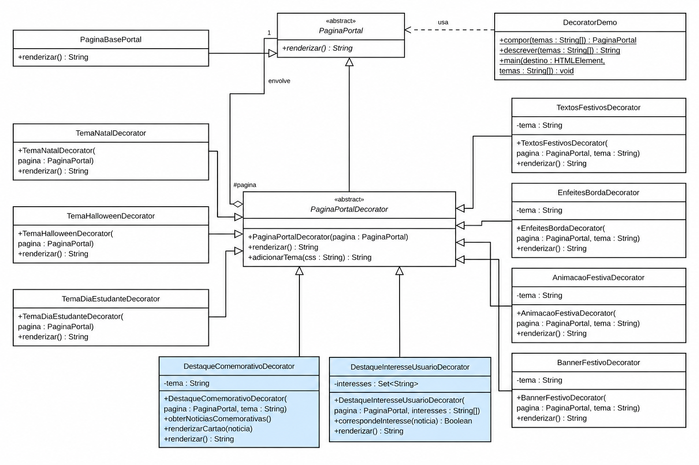
        </a>
        <figcaption style="display: block; width: 100%; max-width: none; margin: 0.75rem auto 0; text-align: center;">Figura: Diagrama UML individual com destaque para a minha contribuição. Fonte: Júlia Gabriella, 2026.</figcaption>
    </figure>

    A diferença funcional entre essas duas classes também aparece na modelagem. `DestaqueComemorativoDecorator` depende do tema ativo e acrescenta novos cartões ao resultado anterior, enquanto `DestaqueInteresseUsuarioDecorator` recebe um conjunto de interesses e identifica visualmente notícias já renderizadas. Ambas reutilizam a delegação de `PaginaPortalDecorator` e podem ser combinadas com as demais camadas da Home.

    ### Vídeo: demonstração da contribuição individual

    O vídeo apresenta a minha contribuição para a Home do Burburinho e a integração dos dois destaques com os temas comemorativos.

    <div style="position: relative; width: 100%; padding-bottom: 56.25%; height: 0; overflow: hidden; border-radius: 8px; margin: 1rem auto;">
        <iframe src="https://drive.google.com/file/d/1P9D5HtQnzro3T6URt0U7o7oTaWahs8Et/preview" title="Demonstração de Júlia Gabriella sobre os Decorators de notícias" loading="lazy" allow="autoplay; fullscreen" allowfullscreen style="position: absolute; inset: 0; width: 100%; height: 100%; border: 0;"></iframe>
    </div>

    <p style="text-align: center;"><a href="https://drive.google.com/file/d/1P9D5HtQnzro3T6URt0U7o7oTaWahs8Et/view?usp=sharing" target="_blank" rel="noopener noreferrer">Abrir minha demonstração no Google Drive</a></p>

    ### Referências

    - SERRANO, Milene. *Arquitetura e Desenho de Software. Aula GoFs Estruturais*. UnB.
    - GAMMA, Erich et al. *Design Patterns: Elements of Reusable Object-Oriented Software*. Addison-Wesley, 1995. Decorator.

## Versionamentos

| Nome do Membro | Contribuição | Data |
| --- | --- | --- |
| Giovanna Aguiar | Elaboração do artefato individual sobre o GoF estrutural Decorator: contexto e justificativa, diagrama UML, implementação em JavaScript dos temas comemorativos da Home, trechos de código comentados e vídeo de demonstração. Registro das lições aprendidas e da análise crítica do uso de IA generativa, com links e capturas das conversas. Revisão da apresentação do bloco individual no Pages. | 15/10/2026 |
| Giovanna Aguiar | Revisão das explicações dos trechos do Decorator: seleção de um tema por vez, construtores dos decoradores, reutilização do auxiliar de paleta e atualização dos textos da Home. Ajuste da escrita para tornar a apresentação mais natural e direta. | 15/10/2026 |
| Giovanna Aguiar | Atualização do diagrama UML para representar a implementação JavaScript: contrato em classe base abstrata, quatro decoradores de efeitos, construtores com o tema e assinaturas atuais do decorador abstrato e do cliente. | 16/10/2026 |
| Johnnatan Salles | Concepção e vetorização das logos temáticas em SVG (Natal, Halloween, Dia do Estudante e Base), implementação da renderização dinâmica de marcas nos decoradores de tema (`Tema*Decorator`) e no componente base (`renderizarHome`), além da documentação do artefato individual com lições aprendidas e análise crítica de IA. | 16/10/2026 |
| Júlia Gabriella | Elaboração do artefato individual da evolução incremental do Decorator com notícias comemorativas e destaque por interesse. Documentação das decisões arquiteturais, registros visuais do apoio crítico de IA generativa, trechos comentados do código, composição das funcionalidades, testes e vídeo. | 17/10/2026 |
| Júlia Gabriella | Atualização da documentação geral e individual com a modelagem UML consolidada, inserção dos vídeos em reprodutores e inclusão do registro adicional da conversa com IA generativa. | 18/10/2026 

--
# Observações:
Entregável: Relatório, documentado no GitPages, revelando:
## Entrega Mínima: um subgrupo com um GoF Criacional (modelo & código & vídeo com o padrão em execução), um subgrupo em um GoF Estrutural (modelo & código & vídeo com o padrão em execução), um subgrupo com um GoF Comportamental (modelo & código & vídeo com o padrão em execução) e pontos de vista de cada membro da equipe sobre as lições aprendidas e uso da IA Generativa. Mira-se no MM, com a entrega mínima.

## Como ir além, para conseguir menções superiores?
Embasar cada artefato gerado e cada decisão tomada na literatura;
Manter rastros claros para o trabalho em equipe (ex. vídeos das reuniões e atas bem elaboradas), evidenciando práticas metodológicas (ex. reuniões periódicas das metodologias ágeis; checklists; debates, e assim vai);
Modelo & Código & Padrão Rodando bem esclarecidos, e
Reportar os pontos de vista de forma fundamentada, clara e com senso crítico.

## 📌A ideia não é quantidade, e sim qualidade do que é entregue.

## Apresentação:
Apresentação (para a professora) explicando o artefato elaborado, com: (i) rastro claro aos membros participantes (MOSTRAR QUADRO DE PARTICIPAÇÕES & COMMITS); (ii) justificativas & senso crítico sobre o trabalho realizado, e (iii) comentários gerais sobre o trabalho em equipe. Tempo da Apresentação: +/- 10min. Recomendação: Apresentar diretamente via Wiki ou GitPages do Projeto. Baixar os conteúdos com antecedência, evitando problemas de internet no momento de exposição nas Dinâmicas de Avaliação.

A Wiki ou GitPages do Projeto deve conter, PARA CADA SUBGRUPO, um tópico dedicado ao relatório com a entrega mínima, versionamentos, referências, e demais detalhamentos gerados pela equipe nesse escopo.
Demais orientações disponíveis nas Diretrizes (vide Aprender3).Recomendação: Apresentar diretamente via Wiki ou GitPages do Projeto. Baixar os conteúdos com antecedência, evitando problemas de internet no momento de exposição nas Dinâmicas de Avaliação.

A Wiki ou GitPages do Projeto deve conter, PARA CADA SUBGRUPO, um tópico dedicado ao relatório com a entrega mínima, versionamentos, referências, e demais detalhamentos gerados pela equipe nesse escopo.
Demais orientações disponíveis nas Diretrizes (vide Aprender3).
