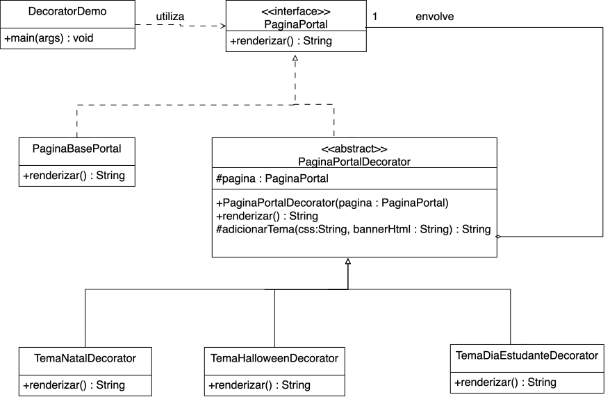

# SubEquipe_03
O relatório deverá conter a estrutura de focos estabelecida a seguir, bem como versionamentos, metodologia e participantes por foco.
Não omitir tópicos.

## Focos do Relatório:
### FOCO_03: GoFs Comportamentais & IA Generativa
Entrega Mínima: um GoF Comportamental (modelo & código & vídeo com o padrão em execução).
### Participantes no Foco_03
| Nome do Membro | Lições Aprendidas | Uso da IA Generativa (SENSO CRÍTICO) |

EXEMPLO:
| Fulano | Compreendi sobre GoFs Comportamentais, com maior destaque ao Padrão Observer, sendo esse o padrão que eu modelei e desenvolvi na linguagem Python. | A IA Generativa ajudou na compreensão geral dos padrões estudados. |

### Metodologia do Foco_03
Espaço para contar um pouco sobre como ocorreu o trabalho em equipe. Vídeos ajudam aqui.
### GoF Comportamental: [Nome do padrão]

#### Contexto (Problema)

[Descrever o problema no portal de notícias e justificar a escolha do padrão.]

#### Modelagem (Notação UML)

[Apresentar a modelagem e explicar as responsabilidades e relações dos participantes do padrão.]

??? note "Diagrama UML: [Nome do padrão] — SubEquipe 03"

    [Adicionar o diagrama em `docs/assets/subGrupo3/` e substituir os campos do modelo abaixo. Remover os marcadores de comentário HTML para exibir a imagem.]

    <!--
    <figure style="text-align: center;">
        <a href="../../../assets/subGrupo3/diagrama-padrao.svg" target="_blank" rel="noopener noreferrer">
            
        </a>
        <figcaption>
            <p style="text-align: center; font-size: 10pt;">
                Figura 1: Diagrama UML do padrão [Nome do padrão]. (Fonte: SubEquipe 03, 2026)
            </p>
            <p style="text-align: center; font-size: 10pt;">
                <a href="../../../assets/subGrupo3/diagrama-padrao.svg" target="_blank" rel="noopener noreferrer">Abrir diagrama em nova página</a>
            </p>
        </figcaption>
    </figure>
    -->

    **Referências:** [Adicionar as referências utilizadas na modelagem.]

#### Implementação (Código & Vídeo com Padrão em Execução)

??? note "Código-fonte: [Nome do padrão]"

    [Adicionar aqui o link para a implementação na pasta Projeto do repositório. Usar a URL do GitHub para que o código possa ser acessado pelo GitPages.]

    <!-- Modelo de link: substituir CAMINHO_DO_CODIGO pelo caminho real dentro de Projeto.
    [Acessar o código-fonte no repositório](https://github.com/UnBArqDsw2026-2-Turma01/2026.2-T01-_G3_ProjetoPortalNoticias_Entrega_03/tree/HEAD/Projeto/CAMINHO_DO_CODIGO)
    -->

    **Organização da implementação**

    | Participante do padrão | Classe / arquivo no projeto | Responsabilidade |
    | --- | --- | --- |
    | [Nome do participante] | [Nome da classe e link para o arquivo] | [Papel na implementação] |

    **Trechos de código e explicação**

    [Inserir os trechos relevantes em blocos de código com a linguagem da implementação e explicar como cada um concretiza o padrão.]

    ```text
    [Substituir pelo trecho de código e ajustar a linguagem deste bloco.]
    ```

    **Como executar**

    [Informar os pré-requisitos, o diretório da implementação e os comandos necessários para executar o exemplo.]

??? note "Vídeo: [Nome do padrão] em execução"

    [Adicionar o link do vídeo demonstrando o código em execução.]

    <!--
    <p style="text-align: center;">
        <a href="URL_DO_VIDEO" target="_blank" rel="noopener noreferrer">Assistir à demonstração do padrão [Nome do padrão]</a>
    </p>
    -->

    **Demonstração:** [Descrever o cenário executado e o comportamento observado.]

#### Artefatos individuais

??? note "GoF Estrutural: Decorator — Giovanna Aguiar"

    **Contexto (Problema)**

    A proposta individual aplica o padrão Decorator à personalização visual das páginas do portal de notícias. O problema considerado é a necessidade de acrescentar temas comemorativos, como Natal, Halloween e Dia do Estudante, preservando a estrutura da página base. A organização proposta permite concentrar as particularidades de cada tema em uma classe própria e acrescentá-las por meio do envolvimento de um objeto que representa a página.

    **Modelagem (Notação UML)**

    O diagrama de classes representa a interface `PaginaPortal`, que define a operação `renderizar() : String` como contrato comum da página e de seus decoradores. A classe `PaginaBasePortal` realiza essa interface e representa o componente concreto sobre o qual as personalizações são aplicadas.

    A classe abstrata `PaginaPortalDecorator` também realiza `PaginaPortal` e mantém uma referência a outro objeto dessa interface no atributo protegido `pagina`. Essa relação permite envolver tanto a página base quanto outro decorador, mantendo o mesmo contrato de renderização. O construtor recebe a página a ser decorada, enquanto o método protegido `adicionarTema(css, bannerHtml)` concentra o suporte à inclusão dos elementos visuais do tema.

    As classes `TemaNatalDecorator`, `TemaHalloweenDecorator` e `TemaDiaEstudanteDecorator` herdam de `PaginaPortalDecorator` e apresentam suas próprias operações `renderizar()`. Elas representam as variações temáticas da proposta, separando as personalizações da responsabilidade de renderizar a página base. Por fim, `DecoratorDemo` representa o cliente que utiliza a interface `PaginaPortal` para demonstrar o uso da estrutura.

    Dessa forma, a modelagem permite estender a apresentação da página por composição de objetos. Para incluir um novo tema, a estrutura prevê a criação de outro decorador concreto, preservando o contrato utilizado pelo cliente.

    <figure style="text-align: center;">
        <a href="../../../assets/subGrupo3/decorator_pagina_portal_classes.svg" target="_blank" rel="noopener noreferrer">
            
        </a>
        <figcaption>
            <p style="text-align: center; font-size: 10pt;">
                Figura: Diagrama de classes do padrão Decorator aplicado à página do portal. (Fonte: <a href="https://github.com/giovannabrito19">Giovanna Aguiar de Brito</a>, 2026)
            </p>
            <p style="text-align: center; font-size: 10pt;">
                <a href="../../../assets/subGrupo3/decorator_pagina_portal_classes.svg" target="_blank" rel="noopener noreferrer">Abrir diagrama em nova página</a>
            </p>
        </figcaption>
    </figure>

    **Implementação (Código)**

    [Adicionar o link para o código individual na pasta Projeto e explicar os trechos que implementam o padrão.]

    <!-- Substituir CAMINHO_DO_CODIGO pelo caminho real dentro de Projeto e remover os marcadores de comentário.
    [Acessar o código individual no repositório](https://github.com/UnBArqDsw2026-2-Turma01/2026.2-T01-_G3_ProjetoPortalNoticias_Entrega_03/tree/HEAD/Projeto/CAMINHO_DO_CODIGO)
    -->

    ```text
    [Substituir pelo trecho de código individual e ajustar a linguagem deste bloco.]
    ```

    **Vídeo com o padrão em execução**

    [Adicionar o link da demonstração individual.]

    **Insights**

    [Registrar as conclusões individuais sobre a aplicação do padrão Decorator ao portal de notícias.]

    **Referências**

    [Adicionar as referências utilizadas para fundamentar a escolha, a modelagem e a implementação da proposta individual.]

## Versionamentos
|Nome do Membro | Contribuição | Data

EXEMPLO:
| Fulano  |  1. Elaboração do Padrão de Projeto GoF Comportamental Observer, com modelagem em UML, código e execução & Ponto de Vista sobre o Uso de IA Generativa | XX/XX/XXXX
OBS: TODOS DEVEM PARTICIPAR, MOSTRANDO SEUS PONTOS DE VISTA E COMO COLABORARAM NA ENTREGA.

--
# Observações: 
Entregável: Relatório, documentado no GitPages, revelando:
## Entrega Mínima: um subgrupo com um GoF Criacional (modelo & código & vídeo com o padrão em execução), um subgrupo em um GoF Estrutural (modelo & código & vídeo com o padrão em execução), um subgrupo com um GoF Comportamental (modelo & código & vídeo com o padrão em execução) e pontos de vista de cada membro da equipe sobre as lições aprendidas e uso da IA Generativa. Mira-se no MM, com a entrega mínima.

## Como ir além, para conseguir menções superiores?
Embasar cada artefato gerado e cada decisão tomada na literatura;
Manter rastros claros para o trabalho em equipe (ex. vídeos das reuniões e atas bem elaboradas), evidenciando práticas metodológicas (ex. reuniões periódicas das metodologias ágeis; checklists; debates, e assim vai);
Modelo & Código & Padrão Rodando bem esclarecidos, e
Reportar os pontos de vista de forma fundamentada, clara e com senso crítico.

## 📌A ideia não é quantidade, e sim qualidade do que é entregue.

## Apresentação:
Apresentação (para a professora) explicando o artefato elaborado, com: (i) rastro claro aos membros participantes (MOSTRAR QUADRO DE PARTICIPAÇÕES & COMMITS); (ii) justificativas & senso crítico sobre o trabalho realizado, e (iii) comentários gerais sobre o trabalho em equipe. Tempo da Apresentação: +/- 10min. Recomendação: Apresentar diretamente via Wiki ou GitPages do Projeto. Baixar os conteúdos com antecedência, evitando problemas de internet no momento de exposição nas Dinâmicas de Avaliação.

A Wiki ou GitPages do Projeto deve conter, PARA CADA SUBGRUPO, um tópico dedicado ao relatório com a entrega mínima, versionamentos, referências, e demais detalhamentos gerados pela equipe nesse escopo.
Demais orientações disponíveis nas Diretrizes (vide Aprender3).Recomendação: Apresentar diretamente via Wiki ou GitPages do Projeto. Baixar os conteúdos com antecedência, evitando problemas de internet no momento de exposição nas Dinâmicas de Avaliação.

A Wiki ou GitPages do Projeto deve conter, PARA CADA SUBGRUPO, um tópico dedicado ao relatório com a entrega mínima, versionamentos, referências, e demais detalhamentos gerados pela equipe nesse escopo.
Demais orientações disponíveis nas Diretrizes (vide Aprender3).
