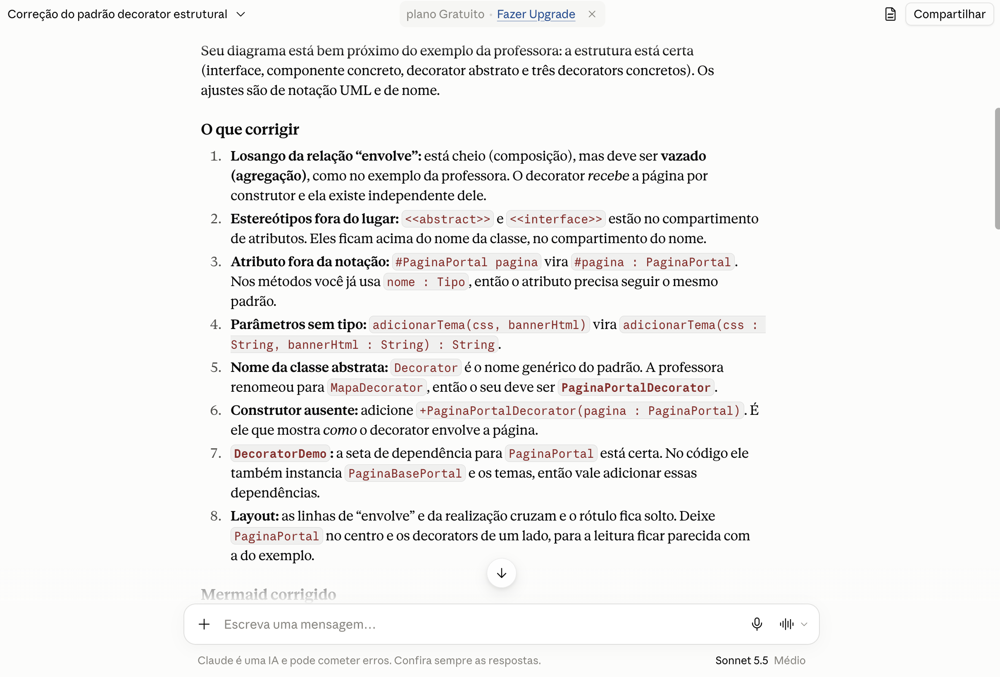
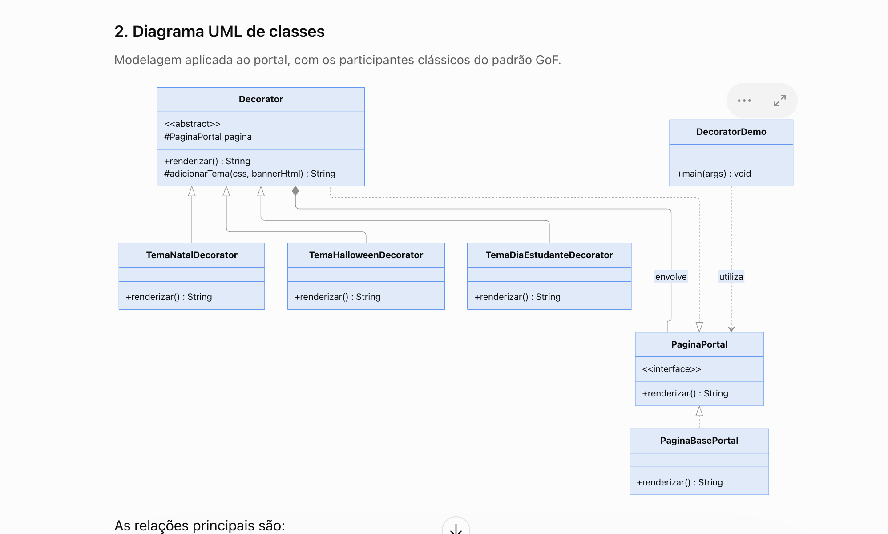
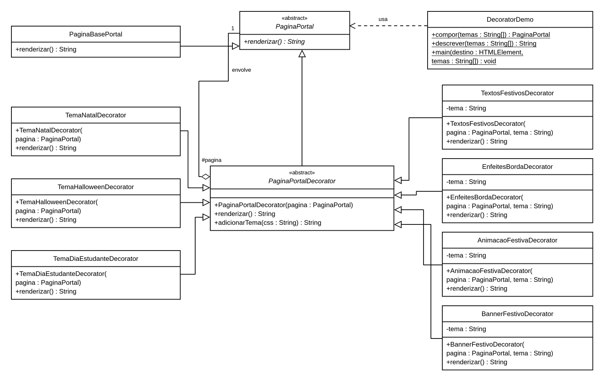

# SubEquipe_03
O relatório deverá conter a estrutura de focos estabelecida a seguir, bem como versionamentos, metodologia e participantes por foco.
Não omitir tópicos.

## Focos do Relatório:
### FOCO_03: GoFs Comportamentais & IA Generativa
Entrega Mínima: um GoF Comportamental (modelo & código & vídeo com o padrão em execução).
### Participantes no Foco_03

| Nome do Membro | Lições Aprendidas | Uso da IA Generativa (SENSO CRÍTICO) |
| --- | --- | --- |
| Giovanna Aguiar | Aplicar o Decorator, do GoF estrutural, me ajudou a entender como a composição de objetos permite acrescentar responsabilidades sem encher a classe base de variações. Na Home do portal, separar paleta, banner, textos, enfeites e animação deixou claro por que o contrato comum, a delegação e a responsabilidade única importam. Também percebi que o padrão precisa se justificar pelo problema: cada classe e camada nova aumenta a complexidade. | Usei IA generativa como apoio para entender o Decorator, analisar o diagrama, implementar e documentar. Revisei as sugestões com base nos materiais da professora e pedi ajustes na separação das responsabilidades e na forma de apresentar o padrão. O detalhamento desse processo, das decisões e dos registros das conversas está em **Artefatos individuais**, na seção **Uso da IA generativa e análise crítica**. |

### Metodologia do Foco_03
Espaço para contar um pouco sobre como ocorreu o trabalho em equipe. Vídeos ajudam aqui.
### GoF Comportamental: [Nome do padrão]

#### Contexto (Problema)

[Descrever o problema no portal de notícias e justificar a escolha do padrão.]

#### Modelagem (Notação UML)

[Apresentar a modelagem e explicar as responsabilidades e relações dos participantes do padrão.]

??? note "Diagrama UML: [Nome do padrão] — SubEquipe 03"

    [Adicionar o diagrama em `docs/assets/subGrupo3/` e substituir os campos do modelo abaixo. Remover os marcadores de comentário HTML para exibir a imagem.]

    <!--
    <figure style="text-align: center;">
        <a href="../../../assets/subGrupo3/diagrama-padrao.svg" target="_blank" rel="noopener noreferrer">
            
        </a>
        <figcaption>
            <p style="text-align: center; font-size: 10pt;">
                Figura 1: Diagrama UML do padrão [Nome do padrão]. (Fonte: SubEquipe 03, 2026)
            </p>
            <p style="text-align: center; font-size: 10pt;">
                <a href="../../../assets/subGrupo3/diagrama-padrao.svg" target="_blank" rel="noopener noreferrer">Abrir diagrama em nova página</a>
            </p>
        </figcaption>
    </figure>
    -->

    **Referências:** [Adicionar as referências utilizadas na modelagem.]

#### Implementação (Código & Vídeo com Padrão em Execução)

??? note "Código-fonte: [Nome do padrão]"

    [Adicionar aqui o link para a implementação na pasta Projeto do repositório. Usar a URL do GitHub para que o código possa ser acessado pelo GitPages.]

    <!-- Modelo de link: substituir CAMINHO_DO_CODIGO pelo caminho real dentro de Projeto.
    [Acessar o código-fonte no repositório](https://github.com/UnBArqDsw2026-2-Turma01/2026.2-T01-_G3_ProjetoPortalNoticias_Entrega_03/tree/HEAD/Projeto/CAMINHO_DO_CODIGO)
    -->

    **Organização da implementação**

    | Participante do padrão | Classe / arquivo no projeto | Responsabilidade |
    | --- | --- | --- |
    | [Nome do participante] | [Nome da classe e link para o arquivo] | [Papel na implementação] |

    **Trechos de código e explicação**

    [Inserir os trechos relevantes em blocos de código com a linguagem da implementação e explicar como cada um concretiza o padrão.]

    ```text
    [Substituir pelo trecho de código e ajustar a linguagem deste bloco.]
    ```

    **Como executar**

    [Informar os pré-requisitos, o diretório da implementação e os comandos necessários para executar o exemplo.]

??? note "Vídeo: [Nome do padrão] em execução"

    [Adicionar o link do vídeo demonstrando o código em execução.]

    <!--
    <p style="text-align: center;">
        <a href="URL_DO_VIDEO" target="_blank" rel="noopener noreferrer">Assistir à demonstração do padrão [Nome do padrão]</a>
    </p>
    -->

    **Demonstração:** [Descrever o cenário executado e o comportamento observado.]

#### Artefatos individuais

??? note decorator-relatorio "Giovanna Aguiar — Gof Estrutural"

    Na minha parte do projeto, escolhi o padrão GoF estrutural **Decorator** para personalizar a Home do Burburinho com temas comemorativos. A ideia é combinar cores, banners e outros efeitos sem precisar alterar a classe que monta a página base.

    ### Introdução ao padrão

    O Decorator permite acrescentar funcionalidades a um objeto envolvendo-o em outros objetos, chamados decoradores. Todos seguem o mesmo contrato. Assim, o código que utiliza a página pode chamar `renderizar()` tanto na página base quanto em uma página decorada. Cada decorador chama a renderização do objeto que recebeu e acrescenta seu efeito.

    Um decorador também pode receber outro decorador, combinando responsabilidades no mesmo objeto. Nesta demonstração, essa composição é feita pelo código: ao escolher uma data, o painel aplica uma combinação pronta de cinco decoradores. Os efeitos não são ativados individualmente pelo usuário.

    ### Contexto (Problema)

    Para demonstrar o padrão, usei três temas na Home: Natal, Halloween e Dia do Estudante. A proposta foi manter as comunidades e a organização do protótipo, acrescentando os efeitos de cada data. Se todas essas regras ficassem na classe da página base, ela também teria que cuidar das particularidades de cada tema.

    Com o Decorator, a página base continua responsável pela Home, e cada efeito fica em uma classe própria. A demonstração usa notícias fictícias, com seis cards, resumos, leitura do texto e busca local.

    ### Uso da IA generativa e análise crítica

    Pedi ajuda à IA para entender melhor o Decorator e como seus participantes apareceriam no código e no diagrama da Home. Usei o protótipo, o diagrama e os slides da professora para orientar os pedidos e comparar as respostas com os exemplos da disciplina.

    Ao revisar o diagrama, percebi que alguns pontos precisavam de ajustes e pedi ajuda para conferir os papéis de Component, ConcreteComponent, Decorator e ConcreteDecorator, além das relações entre eles. Comparei as sugestões com o material da professora.

    Na primeira versão, os temas mudavam principalmente as cores, e achei que isso mostrava pouco do que eu queria demonstrar. Pedi elementos próprios de cada data, como banners, textos, enfeites e animações, com cada responsabilidade em um ConcreteDecorator. Assim, ficou mais fácil enxergar como as camadas se combinam.

    A IA também ajudou a escrever e revisar o código, adaptar a implementação para JavaScript e organizar o relatório. Ao longo desse processo, precisei pedir correções e voltar aos requisitos e ao material da disciplina. Uma tela funcionando, por si só, não mostra se o padrão foi bem aplicado. Por isso, além dos testes e da demonstração, é preciso entender as classes e as relações entre elas.

    **Registros das conversas com IA**

    - [Conversa no Claude](https://claude.ai/share/c4cac0d5-6fbf-4a21-8a00-020b3552e17b).
    - [Conversa no ChatGPT — registro 1](https://chatgpt.com/share/6ad14788-eaec-83e9-8813-57865ad93c9e).
    - [Conversa no ChatGPT — registro 2](https://chatgpt.com/share/6ad147af-a1a8-83e9-9f0b-30b9b60a0c3e).

    **Registros visuais do apoio da IA**

    Abaixo estão dois registros desse processo: as sugestões de correção do Claude e um diagrama gerado pelo ChatGPT. Clique nas imagens para ampliar.

    <figure style="text-align: center;">
        <a href="../../../assets/subGrupo3/ia-claude-revisao-diagrama.png" target="_blank" rel="noopener noreferrer">
            
        </a>
        <figcaption>Figura: Sugestões do Claude para a revisão do diagrama. Fonte: captura de tela de Giovanna Aguiar, 2026.</figcaption>
    </figure>

    <figure style="text-align: center;">
        <a href="../../../assets/subGrupo3/ia-chatgpt-diagrama-gerado.png" target="_blank" rel="noopener noreferrer">
            
        </a>
        <figcaption>Figura: Proposta de diagrama gerada pelo ChatGPT e submetida à análise. Fonte: captura de tela de Giovanna Aguiar, 2026.</figcaption>
    </figure>

    ### Aplicação

    A classe `PaginaBasePortal` monta a Home com o usuário logado. Sobre ela, cada tema combina cinco decoradores: um para as cores, um para os textos, um para os enfeites, um para a animação e um para o banner. O código fica em `demonstracao_codigos/SubGrupo3/decorator/`, com HTML, CSS, imagens e classes JavaScript separados, seguindo a organização do Subgrupo 1. Não é necessário usar framework nem compilar o projeto.

    | Participante do padrão | Elemento no projeto | Responsabilidade |
    | --- | --- | --- |
    | Component | `PaginaPortal` | Define o contrato comum `renderizar()`, que retorna HTML. |
    | ConcreteComponent | `PaginaBasePortal` | Fornece a Home sem personalizações comemorativas. |
    | Decorator | `PaginaPortalDecorator` | Guarda a referência à página e oferece a delegação ao objeto envolvido. |
    | ConcreteDecorators | `Tema*Decorator`, `BannerFestivoDecorator`, `TextosFestivosDecorator`, `EnfeitesBordaDecorator` e `AnimacaoFestivaDecorator` | Acrescentam separadamente as cores e os efeitos da data selecionada. |
    | Client | `DecoratorDemo` | Monta a composição e apresenta o resultado na Home. |

    Ao selecionar Natal, por exemplo, o cliente combina automaticamente os decoradores de textos, enfeites, animação, banner e cores natalinas. Cada um envolve o objeto anterior e acrescenta seu efeito ao resultado de `renderizar()`. O painel troca o conjunto completo ao selecionar outra data; ele não acumula temas nem permite escolher os efeitos separadamente. Ao voltar ao Padrão, o cliente cria uma página base sem os efeitos festivos.

    Essa separação facilita acrescentar e testar cada efeito, mas também aumenta o número de classes e exige atenção à ordem das camadas. Os enfeites ficam nas margens para não atrapalhar a leitura, e as animações respeitam a configuração de movimento reduzido do sistema.

    ### Diagrama

    <figure style="display: block; width: 100%; max-width: none; margin: 1.5rem auto; text-align: center;">
        <a href="../../../assets/subGrupo3/decorator-diagrama-corrigido.png" target="_blank" rel="noopener noreferrer" title="Abrir diagrama em tamanho maior" style="display: block; width: 100%;">
            
        </a>
        <figcaption style="display: block; width: 100%; max-width: none; margin: 0.75rem auto 0; text-align: center;">Fonte: <a href="https://github.com/giovannabrito19" target="_blank" rel="noopener noreferrer">Giovanna Aguiar</a>, 2026.</figcaption>
    </figure>

    ### Trechos de código

    #### Componente

    Como JavaScript não tem interfaces nativas, usei `PaginaPortal` como uma classe base que representa o contrato: ela bloqueia a criação direta de objetos e exige a implementação de `renderizar()`. `PaginaBasePortal` segue esse contrato e monta a Home sem precisar conhecer os temas.


    ```javascript
    export class PaginaPortal {
      constructor() {
        if (new.target === PaginaPortal) {
          throw new Error('PaginaPortal é um contrato: use uma página concreta ou um decorador.');
        }
      }
      renderizar() {
        throw new Error('renderizar() deve ser implementado.');
      }
    }

    export class PaginaBasePortal extends PaginaPortal {
      renderizar() {
        return renderizarHome();
      }
    }
    ```

    #### Decorator abstrato

    `PaginaPortalDecorator` guarda o objeto recebido em `this.pagina` e delega a ele a chamada de `renderizar()`. Esse objeto pode ser a página base ou outro decorador. Nesta demonstração, o cliente combina automaticamente os cinco decoradores do tema selecionado.


    ```javascript
    export class PaginaPortalDecorator extends PaginaPortal {
      constructor(pagina) {
        super();
        if (new.target === PaginaPortalDecorator) {
          throw new Error('Use um decorador concreto.');
        }
        this.pagina = pagina;
      }

      renderizar() {
        return this.pagina.renderizar();
      }

      adicionarTema(css) {
        return `<section class="tema" style="${css}">
          ${this.pagina.renderizar()}
        </section>`;
      }
    }
    ```

    O método `adicionarTema(css)` reúne a montagem do contêiner usado pelas três paletas. Cada decorador de cores informa seus valores, reutilizando essa montagem sem repetir o mesmo HTML.

    #### ConcreteDecorator de paleta

    `TemaNatalDecorator` aproveita o construtor do decorador abstrato, define as cores de Natal e substitui a marca pelo logo temático (`BurburinhoNatal.svg`). O método auxiliar `adicionarTema()` envolve o HTML da página com essas cores, sem precisar reescrever a Home.


    ```javascript
    export class TemaNatalDecorator extends PaginaPortalDecorator {
        renderizar() {
            return this.adicionarTema('--destaque:#ba303b;--barra:#173b31;--fundo:#fffaf3;--cartao:#fffdf8;--texto:#172d25;--borda:#cfa85b;--suave:#52645a;')
                .replace('LogoBurburinho.svg', 'BurburinhoNatal.svg');
        }
    }
    ```

    #### ConcreteDecorator de banner

    `this.tema` é definido pelo construtor de cada decorador que precisa dos dados da data. O construtor chama `super(pagina)` para guardar o componente e salva o tema na própria instância. Banner, animação, enfeites e textos seguem essa estrutura; os decoradores de paleta já representam uma data específica.

    ```javascript
    // Construtor de BannerFestivoDecorator.
    constructor(pagina, tema) {
      super(pagina);
      this.tema = tema;
    }
    ```

    Em `BannerFestivoDecorator.renderizar()`, o tema identifica os dados do cabeçalho. `super.renderizar()` recupera o resultado do objeto envolvido. O ornamento complementar foi omitido deste trecho.


    ```javascript
    const { nome, data, simbolo, mensagem } = temas[this.tema];
    return `<div class="camada-banner">
      <header class="banner-tema" role="note">
        <span class="simbolo-banner" aria-hidden="true">${simbolo}</span>
        <div><strong>${nome} · ${data}</strong><p>${mensagem}</p></div>
      </header>
      ${super.renderizar()}
    </div>`;
    ```

    #### ConcreteDecorator de animação

    Trecho de `AnimacaoFestivaDecorator.renderizar()`: acrescenta as partículas e preserva o resultado do componente envolvido por meio de `super.renderizar()`. Essa classe cuida somente da animação; banner, textos e cores são acrescentados por outros decoradores.


    ```javascript
    const particulas = temas[this.tema].particulas.map((simbolo, indice) =>
      `<span class="particula particula-${indice}">${simbolo}</span>`,
    ).join('');
    return `<div class="camada-animada">
      <div class="particulas particulas-${this.tema}" aria-hidden="true">${particulas}</div>
      ${super.renderizar()}
    </div>`;
    ```

    #### ConcreteDecorator de textos

    Trecho de `TextosFestivosDecorator.renderizar()`: adapta a saudação e o título da seção nos espaços identificados pela Home. A mesma classe também atualiza os selos dos cards, preservando os títulos das notícias e as categorias.

    A Home identifica os espaços de personalização com atributos como `data-saudacao` e `data-titulo-secao`. O decorador usa essas marcações para atualizar os textos e é aplicado diretamente à página base, antes dos efeitos visuais. Se essas marcações mudarem, as substituições precisam acompanhar a alteração.


    ```javascript
    const { saudacao, secao, selo } = temas[this.tema];
    return super.renderizar()
      .replace(/(<h1 data-saudacao>)[^<]*(<\/h1>)/, `$1${saudacao}, ${nomeUsuario}!$2`)
      .replace(/(<h2 id="titulo-ultimas" data-titulo-secao>)[^<]*(<\/h2>)/, `$1${secao}$2`)
      // As substituições dos selos continuam no arquivo completo.
    ```

    #### Definição das camadas

    A função `camadas(tema)` define a combinação pronta usada em cada seleção do painel. Ela escolhe a classe de cores da data e inclui os quatro decoradores de textos, enfeites, animação e banner. Esses quatro recebem a data como configuração.


    ```javascript
    const paletas = {
      natal: TemaNatalDecorator,
      halloween: TemaHalloweenDecorator,
      estudante: TemaDiaEstudanteDecorator,
    };
    const camadas = (tema) => [
      TextosFestivosDecorator, EnfeitesBordaDecorator, AnimacaoFestivaDecorator,
      BannerFestivoDecorator, paletas[tema],
    ];
    ```

    #### Uso na Home

    O cliente começa com a página base e a envolve com os decoradores do tema escolhido. No fim, chama `renderizar()` para mostrar o resultado na Home. O painel permite alternar os temas durante a demonstração e voltar ao Padrão. Em um portal em produção, essa escolha poderia ser feita pelo calendário ou por uma configuração administrativa, usando os mesmos decoradores.


    O painel envia a data selecionada em um array `temas` com um único item. Ao escolher Padrão, envia um array vazio. Assim, o loop combina automaticamente os cinco efeitos da data escolhida e cada troca começa com uma nova página base.

    ```javascript
    let pagina = new PaginaBasePortal();
    for (const tema of temas) {
      for (const Camada of camadas(tema)) pagina = new Camada(pagina, tema);
    }
    // Em DecoratorDemo.main():
    destino.innerHTML = this.compor(temas).renderizar();
    ```

    ### Vídeo: Decorator em execução

    Gravação da demonstração da Home com os temas comemorativos, anterior à migração para JavaScript e à ampliação das notícias. O vídeo registra os mesmos efeitos festivos, mas os textos das notícias foram atualizados na versão atual. A reprodução é automática, sem som e em loop, como um GIF; os controles permitem pausar e avançar.

    <video autoplay loop muted playsinline controls preload="metadata" poster="../../../assets/subGrupo3/decorator-demo-natal.jpg" style="display: block; width: 100%; height: auto; border-radius: 8px;" aria-label="Demonstração do padrão Decorator nos temas da Home do Burburinho">
        <source src="../../../assets/subGrupo3/decorator-demonstracao.mp4" type="video/mp4">
        Seu navegador não reproduz este vídeo. Use o link abaixo para abrir a gravação.
    </video>

    <p style="text-align: center;">
        <a href="../../../assets/subGrupo3/decorator-demonstracao.mp4" target="_blank" rel="noopener noreferrer">Abrir a demonstração em outra aba</a>
    </p>

    ### Referências

    - SERRANO, Milene. *Arquitetura e Desenho de Software — Aula GoFs Estruturais*. UnB. Slides 59–60.
    - GAMMA, Erich et al. *Design Patterns: Elements of Reusable Object-Oriented Software*. Addison-Wesley, 1995. Decorator.
    - [SourceMaking — Decorator](https://sourcemaking.com/design_patterns/decorator/java/1).

## Versionamentos

| Nome do Membro | Contribuição | Data |
| --- | --- | --- |
| Giovanna Aguiar | Elaboração do artefato individual sobre o GoF estrutural Decorator: contexto e justificativa, diagrama UML, implementação em JavaScript dos temas comemorativos da Home, trechos de código comentados e vídeo de demonstração. Registro das lições aprendidas e da análise crítica do uso de IA generativa, com links e capturas das conversas. Revisão da apresentação do bloco individual no Pages. | 15/10/2026 |
| Giovanna Aguiar | Revisão das explicações dos trechos do Decorator: seleção de um tema por vez, construtores dos decoradores, reutilização do auxiliar de paleta e atualização dos textos da Home. Ajuste da escrita para tornar a apresentação mais natural e direta. | 15/10/2026 |
| Giovanna Aguiar | Atualização do diagrama UML para representar a implementação JavaScript: contrato em classe base abstrata, quatro decoradores de efeitos, construtores com o tema e assinaturas atuais do decorador abstrato e do cliente. | 16/10/2026 |

--
# Observações:
Entregável: Relatório, documentado no GitPages, revelando:
## Entrega Mínima: um subgrupo com um GoF Criacional (modelo & código & vídeo com o padrão em execução), um subgrupo em um GoF Estrutural (modelo & código & vídeo com o padrão em execução), um subgrupo com um GoF Comportamental (modelo & código & vídeo com o padrão em execução) e pontos de vista de cada membro da equipe sobre as lições aprendidas e uso da IA Generativa. Mira-se no MM, com a entrega mínima.

## Como ir além, para conseguir menções superiores?
Embasar cada artefato gerado e cada decisão tomada na literatura;
Manter rastros claros para o trabalho em equipe (ex. vídeos das reuniões e atas bem elaboradas), evidenciando práticas metodológicas (ex. reuniões periódicas das metodologias ágeis; checklists; debates, e assim vai);
Modelo & Código & Padrão Rodando bem esclarecidos, e
Reportar os pontos de vista de forma fundamentada, clara e com senso crítico.

## 📌A ideia não é quantidade, e sim qualidade do que é entregue.

## Apresentação:
Apresentação (para a professora) explicando o artefato elaborado, com: (i) rastro claro aos membros participantes (MOSTRAR QUADRO DE PARTICIPAÇÕES & COMMITS); (ii) justificativas & senso crítico sobre o trabalho realizado, e (iii) comentários gerais sobre o trabalho em equipe. Tempo da Apresentação: +/- 10min. Recomendação: Apresentar diretamente via Wiki ou GitPages do Projeto. Baixar os conteúdos com antecedência, evitando problemas de internet no momento de exposição nas Dinâmicas de Avaliação.

A Wiki ou GitPages do Projeto deve conter, PARA CADA SUBGRUPO, um tópico dedicado ao relatório com a entrega mínima, versionamentos, referências, e demais detalhamentos gerados pela equipe nesse escopo.
Demais orientações disponíveis nas Diretrizes (vide Aprender3).Recomendação: Apresentar diretamente via Wiki ou GitPages do Projeto. Baixar os conteúdos com antecedência, evitando problemas de internet no momento de exposição nas Dinâmicas de Avaliação.

A Wiki ou GitPages do Projeto deve conter, PARA CADA SUBGRUPO, um tópico dedicado ao relatório com a entrega mínima, versionamentos, referências, e demais detalhamentos gerados pela equipe nesse escopo.
Demais orientações disponíveis nas Diretrizes (vide Aprender3).
