```mermaid
classDiagram
direction TB
    class CriadorDeComunidade {
        -factory: ComunidadeFactory
        -passos: List~String~
        +CriadorDeComunidade(factory: ComunidadeFactory)
        +montarConfiguracao(nome: String, descricao: String) ConfiguracaoComunidade
        -garantirMesmaFamilia(produtos: List) void
    }

    class ComunidadeFactory {
        +definirFactory(categoria: String)$ ComunidadeFactory
        +criarTema() TemaVisual
        +criarPoliticaModeracao() PoliticaModeracao
        +criarWidgetPadrao() WidgetPadrao
    }

    class ComunidadeTecnologiaFactory {
        +criarTema() TemaVisual
        +criarPoliticaModeracao() PoliticaModeracao
        +criarWidgetPadrao() WidgetPadrao
    }
    class ComunidadeEsportesFactory {
        +criarTema() TemaVisual
        +criarPoliticaModeracao() PoliticaModeracao
        +criarWidgetPadrao() WidgetPadrao
    }
    class ComunidadeCulturaFactory {
        +criarTema() TemaVisual
        +criarPoliticaModeracao() PoliticaModeracao
        +criarWidgetPadrao() WidgetPadrao
    }
    class ComunidadePoliticaFactory {
        +criarTema() TemaVisual
        +criarPoliticaModeracao() PoliticaModeracao
        +criarWidgetPadrao() WidgetPadrao
    }

    class TemaVisual {
        #familia: String
        #corPrimaria: String
        #corSecundaria: String
        #icone: String
        #banner: String
        +aplicar(pagina: HTMLElement) void
    }
    class TemaTecnologia
    class TemaEsportes
    class TemaCultura
    class TemaPolitica

    class PoliticaModeracao {
        #familia: String
        #nivelRigor: String
        #exigeAprovacaoPrevia: boolean
        #regra: String
        +moderar(conteudo: String) boolean
    }
    class PoliticaModeracaoTecnica
    class PoliticaModeracaoEsportes
    class PoliticaModeracaoCultura
    class PoliticaModeracaoPolitica

    class WidgetPadrao {
        #familia: String
        #titulo: String
        #posicao: String
        #itens: List~String~
        +renderizar() String
    }
    class WidgetTrendingTags
    class WidgetPlacarAoVivo
    class WidgetAgendaCultura
    class WidgetPautaPolitica

    class ConfiguracaoComunidade {
        -nome: String
        -descricao: String
        -tema: TemaVisual
        -moderacao: PoliticaModeracao
        -widget: WidgetPadrao
    }

    class Comunidade {
        -corTema: String
        -regrasModeracao: String
        +atualizarDados(descricao: String, regras: String) void
    }

    <<abstract>> ComunidadeFactory
    <<abstract>> TemaVisual
    <<abstract>> PoliticaModeracao
    <<abstract>> WidgetPadrao

    note for ComunidadeFactory "definirFactory() recebe a categoria escolhida
    na área de criação de comunidade e devolve
    a fábrica concreta correspondente"

    CriadorDeComunidade o--> ComunidadeFactory : factory
    CriadorDeComunidade --> TemaVisual : usa
    CriadorDeComunidade --> PoliticaModeracao : usa
    CriadorDeComunidade --> WidgetPadrao : usa
    CriadorDeComunidade ..> ConfiguracaoComunidade : cria
    ConfiguracaoComunidade ..> Comunidade : preenche corTema e regrasModeracao

    ComunidadeFactory <|-- ComunidadeTecnologiaFactory
    ComunidadeFactory <|-- ComunidadeEsportesFactory
    ComunidadeFactory <|-- ComunidadeCulturaFactory
    ComunidadeFactory <|-- ComunidadePoliticaFactory

    TemaVisual <|-- TemaTecnologia
    TemaVisual <|-- TemaEsportes
    TemaVisual <|-- TemaCultura
    TemaVisual <|-- TemaPolitica
    PoliticaModeracao <|-- PoliticaModeracaoTecnica
    PoliticaModeracao <|-- PoliticaModeracaoEsportes
    PoliticaModeracao <|-- PoliticaModeracaoCultura
    PoliticaModeracao <|-- PoliticaModeracaoPolitica
    WidgetPadrao <|-- WidgetTrendingTags
    WidgetPadrao <|-- WidgetPlacarAoVivo
    WidgetPadrao <|-- WidgetAgendaCultura
    WidgetPadrao <|-- WidgetPautaPolitica

    ComunidadeTecnologiaFactory ..> TemaTecnologia : cria
    ComunidadeTecnologiaFactory ..> PoliticaModeracaoTecnica : cria
    ComunidadeTecnologiaFactory ..> WidgetTrendingTags : cria

    ComunidadeEsportesFactory ..> TemaEsportes : cria
    ComunidadeEsportesFactory ..> PoliticaModeracaoEsportes : cria
    ComunidadeEsportesFactory ..> WidgetPlacarAoVivo : cria

    ComunidadeCulturaFactory ..> TemaCultura : cria
    ComunidadeCulturaFactory ..> PoliticaModeracaoCultura : cria
    ComunidadeCulturaFactory ..> WidgetAgendaCultura : cria

    ComunidadePoliticaFactory ..> TemaPolitica : cria
    ComunidadePoliticaFactory ..> PoliticaModeracaoPolitica : cria
    ComunidadePoliticaFactory ..> WidgetPautaPolitica : cria
```

# Abstract Factory de Comunidades

<button type="button" data-af-zoom="out" aria-label="Diminuir zoom">−</button>
<button type="button" data-af-zoom="reset" aria-label="Restaurar zoom">100%</button>
<button type="button" data-af-zoom="in" aria-label="Aumentar zoom">+</button>

