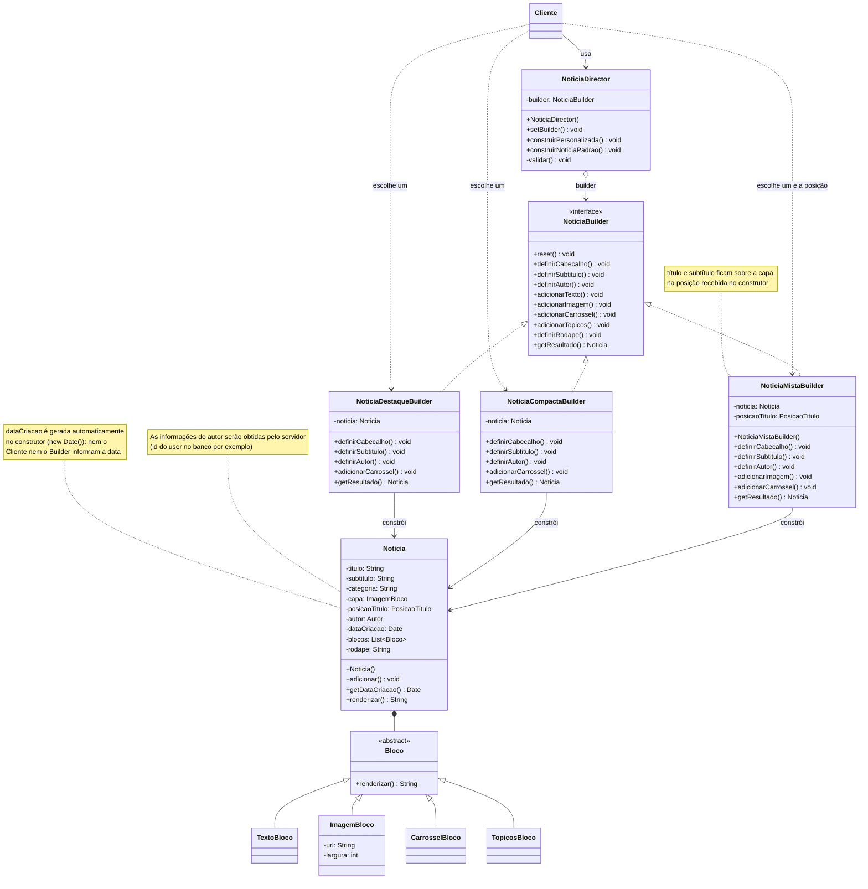

# Builder de notícias com Director



## Código do diagrama

```text
classDiagram
direction TB
    class Cliente {
    }

    class NoticiaDirector {
	    -builder: NoticiaBuilder
	    +NoticiaDirector()
	    +setBuilder() void
	    +construirPersonalizada() void
	    +construirNoticiaPadrao() void
	    -validar() void
    }

    class NoticiaBuilder {
	    +reset() void
	    +definirCabecalho() void
	    +definirSubtitulo() void
	    +definirAutor() void
	    +adicionarTexto() void
	    +adicionarImagem() void
	    +adicionarCarrossel() void
	    +adicionarTopicos() void
	    +definirRodape() void
	    +getResultado() Noticia
    }

    class NoticiaDestaqueBuilder {
	    -noticia: Noticia
	    +definirCabecalho() void
	    +definirSubtitulo() void
	    +definirAutor() void
	    +adicionarCarrossel() void
	    +getResultado() Noticia
    }

    class NoticiaCompactaBuilder {
	    -noticia: Noticia
	    +definirCabecalho() void
	    +definirSubtitulo() void
	    +definirAutor() void
	    +adicionarCarrossel() void
	    +getResultado() Noticia
    }

    class NoticiaMistaBuilder {
	    -noticia: Noticia
	    -posicaoTitulo: PosicaoTitulo
	    +NoticiaMistaBuilder()
	    +definirCabecalho() void
	    +definirSubtitulo() void
	    +definirAutor() void
	    +adicionarImagem() void
	    +adicionarCarrossel() void
	    +getResultado() Noticia
    }

    class Noticia {
	    -titulo: String
	    -subtitulo: String
	    -categoria: String
	    -capa: ImagemBloco
	    -posicaoTitulo: PosicaoTitulo
	    -autor: Autor
	    -dataCriacao: Date
	    -blocos: List~Bloco~
	    -rodape: String
	    +Noticia()
	    +adicionar() void
	    +getDataCriacao() Date
	    +renderizar() String
    }

    class Bloco {
	    +renderizar() String
    }

    class TextoBloco {
    }

    class ImagemBloco {
	    -url: String
	    -largura: int
    }

    class CarrosselBloco {
    }

    class TopicosBloco {
    }

	<<interface>> NoticiaBuilder
	<<abstract>> Bloco

	note for Noticia "dataCriacao é gerada automaticamente
no construtor (new Date()): nem o
Cliente nem o Builder informam a data"
	note for NoticiaMistaBuilder "título e subtítulo ficam sobre a capa,
na posição recebida no construtor"
	note for Noticia "As informações do autor serão obtidas pelo servidor
	(id do user no banco por exemplo)"

    Cliente --> NoticiaDirector : usa
    Cliente ..> NoticiaDestaqueBuilder : escolhe um
    Cliente ..> NoticiaCompactaBuilder : escolhe um
    Cliente ..> NoticiaMistaBuilder : escolhe um e a posição
    NoticiaDirector o--> NoticiaBuilder : builder
    NoticiaBuilder <|.. NoticiaDestaqueBuilder
    NoticiaBuilder <|.. NoticiaCompactaBuilder
    NoticiaBuilder <|.. NoticiaMistaBuilder
    NoticiaDestaqueBuilder --> Noticia : constrói
    NoticiaCompactaBuilder --> Noticia : constrói
    NoticiaMistaBuilder --> Noticia : constrói
    Noticia *-- Bloco
    Bloco <|-- TextoBloco
    Bloco <|-- ImagemBloco
    Bloco <|-- CarrosselBloco
    Bloco <|-- TopicosBloco
```
